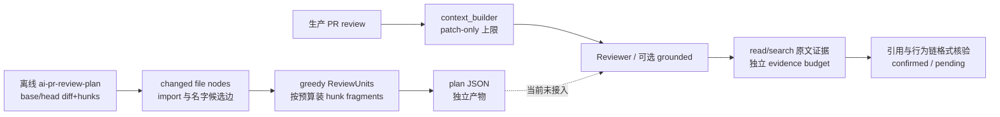

# AI PR Review 交接手册

更新日期：2026-10-15。本文件是新接手者的独立入口：记录用户原话、仓库事实、实现边界和评测纪律。PRD 与开发手册中的 D1–D5 是历史组织草案，不代表用户已批准按阶段自动续做；每次开发前以最新用户决定和可复现失败为准。

## 本轮（2026-10-15）：chunk 会计与预算账本

用户决定：先**止损立基线**——不调用真实模型，重点检查变更切分/分组（chunk、ReviewUnit）结构的诚实性与可测性。用户确认“之前测试结构不太好”指的是变更切分/分组结构这一层。

已实现（当前工作区，未提交）：

1. `ChangeSlice.lines`（`LineSpan`）：每个片段报告它覆盖的 new/old 源码行区间，以及边界是否切在行中间（`cuts_a_diff_line`）。此前只有 `hunk_index`/`fragment_index`，无法把 fragment 映回源码行。
2. `ReviewPlan.coverage_summary`：`unaccounted_hunks`/`unaccounted_files` 必须为空、`complete=true` 才表示每个解析到的 hunk 与变更文件都有切片或解释。这是防止“静默丢 chunk”的回归不变量。
3. `ReviewPlan.budgets` / `ReviewContext.budgets`（`BudgetReport`/`BudgetLine`/`Omission`，定义在 `src/application/protocol.py`）：统一词汇加 `scope`；`limit=None` 表示测量值而非强制上限，`covers` 写明每个数字约束什么、不约束什么。planner 四行，生产三行（`context_pack`/`patch_context`/`per_file_patch`）。
4. 生产上下文只读冻结 SHA：删除 `_fetch_repo_file_text` 的 `main` 回退与移动分支读取；分支名、缺失 SHA、读取失败都只返回 `None`，并记 `no_frozen_ref`/`patch_unavailable`。
5. 生产侧不再静默丢文件：`patch_without_hunks`、`patch_parse_failed`、`patch_processing_error`、`patch_clipped`、`full_file_substituted_*` 全部进入 `ReviewContext.omissions`；前三类同时进入 `skipped_files`（报告已有渲染），裁剪/替换经 `partial_inclusion_warning()` 变成报告里的显式警告。
6. `src/analyzer/git_loader.py`：plan CLI 与基线脚本共用同一套冻结范围读取，避免两处漂移。
7. `scripts/plan_baseline.py` + `src/analyzer/plan_baseline.py` + 产物 `docs/evaluation/plan-baseline-89943fe-13e9a3e.json`：确定性离线基线，记录覆盖、账本、行映射、切边计数与 planner 版本。

验证（本轮实跑，命令见文末“本地常用验证”）：**217 passed**；`ruff check --select E9,F63,F7,F82 src tests` 通过；新增/修改文件全量 Ruff 通过，`context_builder.py` 长行内容集相对 HEAD 无新增。基线 `89943fe → 13e9a3e`、budget=1000：14 units / 23 slices / 22 planned hunks / `complete=true` / `omission_reasons={}`，238 strong + 970 weak 关系，17 条被跨组切开的强边，39 个变更符号的外部调用方——与历史记录一致，说明新增账本没有改变分组结果。

已知限制（不要外推）：以上证明的是会计、冻结引用与可复现性，不是分组质量、Recall 或费用。生产主审查仍未消费 `ReviewPlan` 产物；预算仍是各产物各自的账本，不是一次运行的总账；`patch_clipped` 的取舍未按语义单元对齐；真实范围内 `slices_cutting_a_diff_line=0`（切行目前只出现在超长行 fixture）。

下一步候选（待用户确认）：在基线上先固定一个真实反例，再决定是把 planner 产物接入生产链，还是改切分/绑定算法。

### 第二轮追加（2026-10-15，commit `545ece9`）：生产侧 chunk 覆盖 + 对照基线

第一轮只给 planner 做了账本，但**真正决定模型看到什么的是 `build_review_context`**。第二轮补上，并在同一冻结区间做出两侧对照：

1. `ChunkCoverage` / `ChunkCoverageSummary`：**每个变更文件一条**（`mode` diff/substituted、`status` included/partial/excluded、hunk 级 complete/partial/omitted + reason）。`complete` 只声明"没有文件没被解释"。未被任何分支处理的文件保持 `not_processed` → 落进 `unaccounted_files`。
2. **分母稳定性修复**：预算耗尽的文件此前直接 `continue`，hunks 从未计数，于是 `hunks_total` 随预算缩小而缩小（1000 token 预算下从 22 掉到 18），任何覆盖率都会说谎。现在这类文件仍记 `hunks_total = hunks_omitted = len(hunks)`。
3. **`status` 三态收紧**：一个 hunk 都没完整进去时记 `excluded + patch_budget_too_small`，不再用 `partial` 夸大。
4. **`mode="substituted"` 不计入 hunk 统计**（整文件替换的 hunk 覆盖按定义未知）。
5. **源码策略分歧修复（窄口径）**：planner 用 `safe_source_path`，生产 prompt 此前只做 `_skip_patch_reason`，于是 `.env*` / `.pem` / `node_modules` 的 diff **会进模型 prompt 并可能随公开评论发出**。改用 `_secret_adjacent_reason()` 拒绝密钥材料与已签入构建产物，原因记账；**刻意不套用 `safe_source_path`**，因为它会连带排除 `go.mod`、`requirements.txt`、`.css` 等正常该审的文件（有边界测试）。
6. **对照基线**：`scripts/context_baseline.py` + `docs/evaluation/context-baseline-89943fe-13e9a3e.json`（`remote_fetch=false`、`context_pack=false`、无模型）。

`89943fe → 13e9a3e`、13 文件、22 hunk，patch budget 阶梯：

| patch budget | 文件 included/partial/excluded | hunk complete/partial/omitted | 分母 |
|---:|---|---|---:|
| 1000 | 3 / 6 / 4 | 5 / 6 / 11 | 22 |
| 2000 | 5 / 6 / 2 | 9 / 6 / 7 | 22 |
| 4000 | 7 / 6 / 0 | 13 / 6 / 3 | 22 |
| **6000（生产默认）** | **9 / 4 / 0** | **18 / 4 / 0** | **22** |

同一产物里 `hunk_totals_match=true`（两侧对"有多少 hunk"答案一致），`hunks_planned_not_complete_in_context=4`。**结论：默认预算下没有文件被完全丢弃，但 22 个 hunk 有 4 个只部分进入 prompt；仅按文件粒度记账会把 13 个文件全记成"已包含"，这 4 个 hunk 的损失不可见。**

验证：`pytest 228 passed`；CI 最低 Ruff gate 通过；`context_builder.py` 长行内容集相对 HEAD 无新增（该文件 lint 数从基线 17 降到 14）。

### 研究文档（同轮，独立于代码增量）

`docs/code-review-practices-and-prompt-design.md`：业界 review 实践 + 生产级 prompt 解剖 + 置信度锚点设计 + ReviewBench 指标定义陷阱 + 对本仓库的改造建议。它**纠正了三处常见错误归属**：评论分类占比出自 Bacchelli & Bird ICSE 2013（不是 Google 那篇）；`≥80` 阈值出自 `pr-review-toolkit/agents/code-reviewer.md`（`claude-code` 的 `code-review.md` 里没有）；"Code Review Pyramid" 作者是 Gunnar Morling。原始抓取件在仓库外 `research/`（`ai-code-review-prompts.md`、`ai-code-review-architecture-and-metrics.md`、`raw/`）。

### 第三轮（2026-10-15，commit `2e0ff52`）：一次运行的预算总账

前两轮是**各产物各自的账本**；这一轮补上"这次审查一共往 prompt 里放了多少 token"：

1. `RunBudgetReport`（在 `src/models.py`，与 `BudgetReport` 同层）：聚合各 scope，`capped_scopes` 指明哪些计入总量，`cap` 是可选上限。**`cap=None` 时只测量不判定**，默认行为零变化。
2. `BudgetLine.aggregate`：`per_file_patch` 这类**子集 cap** 标 `False`，不加进总量（否则会被重复计入 patch 总量）。`total_used` 统计 capped scope 的所有 aggregate 行，**与该行自己有没有 limit 无关**——没配 limit 的输入仍然是输入。
3. `EvidenceBundle.budget_report`（scope `repository_evidence`）：`source_unavailable` / `line_out_of_range` / `evidence_budget_exhausted` / `evidence_evicted_for_requested_context` 现在与其他遗漏同构可汇总。
4. `src/reviewer/budget.py`：定义 `REVIEW_INPUT_SCOPES = ("build_review_context", "repository_evidence")` 并把超限/超 cap 变成 `analysis_warnings` 里的可见行；普通路径与 grounded 路径都挂载账本。
5. `Settings.max_review_input_tokens` 默认 **None**（`MAX_REVIEW_INPUT_TOKENS`）——有能力对齐 pr-agent 的 `max_model_tokens=32000`，但**默认不打开**，因为收紧预算会减少模型可见 diff，属质量取舍而非纯可靠性问题。
6. 契约下移：`BudgetLine`/`Omission`/`BudgetReport`/`FrozenContract` 从 `application/protocol.py` 移到 `models.py`（报告契约要携带它们，否则循环依赖），`protocol.py` 原样 re-export，调用点不变。

边界：`total_used` 只覆盖 patch 上下文 + 证据摘录，**不含** system prompt、模型输出与供应商 KV 缓存；`cap` 不是费用上限。验证 `pytest 236 passed`，CI Ruff gate 通过，改动文件长行相对 HEAD 无新增。

**目标剩余项（截至第三轮结束时已被第四轮解决，见下）**：`消除静默降级` 曾只完成了一部分——chunk/覆盖层面的静默丢失已消除（含 `main` 回退、部分包含可见化），但**全仓 76 处 `except Exception`、engine 的兜底 catch-all、CLI 里多处 `except Exception: pass` 仍未处理**。

### 第四轮（2026-10-15，commit `c2ac43d`）：静默降级收口

判定标准、三类允许形态与当前清单见新文档 [docs/error-handling-policy.md](docs/error-handling-policy.md)。这一轮按"用户可见风险"排序，而不是按数量：

1. **上游入口不再能静默缩小变更文件集**（`src/github/client.py`）。`get_changed_files` / `get_compare` 此前对单个条目 `except Exception: continue`——文件会在**任何覆盖记账看到它之前**消失，于是前两轮建立的 `coverage_summary.complete=true` 仍然成立却少审了文件。现在字段类型异常由 `_changed_file()` **净化**（坏类型→`0`/`None`，文件仍进列表），真正不可表示（非 dict / 缺 filename）的条目**抛 `GitHubApiError` 并带条目序号**。`list_pull_requests` 是便利索引而非审查输入，仍跳过但改为 `logger.warning`。
2. **CLI 6 处**（`src/cli/main.py`，原 4 处 `pass`）：`_warn_step_summary_failure()` 同时打印 console 并在有报告时写入 `analysis_warnings`——此前 CI 看起来"什么都没报"而运行自认为成功。失败报告的逐文件列表保证每个文件一行，不再因格式化异常少一行。
3. **分析器 6 处静默 `continue`**（`ast_rules.py` / `cross_file.py` / `risk_rules.py`）：规则抛错、hunk 解析失败、visitor 崩溃、逐行扫描失败全部改为**带文件与规则 id** 的 `logger.warning`；"规则没跑"与"规则没命中"不再无法区分。
4. **证据门不再把工具缺口说成模型错误**（`evidence_validator.py`）：文件没有可解析 hunk 时，其 added lines 不进证据表，此前落在该文件的建议会被判为 *"Cited location is not an added line in this diff."*（把"我们读不到"写成"模型编造"）。现在记为 *"Changed file has no parseable diff hunk…"*——仍然拒绝（无法核验），但原因诚实。
5. Web 历史列表的损坏条目改为 `logging.warning`。

**结果**：生产路径（`src/` 排除 `src/evaluation/`）的静默 `pass`/`continue` 从 12 处降到 **1 处**，且该处是 `_node_source()` 的**记录式降级**（返回 `f"Line {lineno}"` 本身即标记）。全仓宽泛 `except Exception` 从 74 → 71（`log` 22 → 33，`pass` 5 → 1）。验证 `pytest 246 passed`，CI Ruff gate 通过，改动文件长行相对 HEAD 无新增。

**下一轮候选（已被第五轮解决，见下）**：分析器层的 warning 目前只进日志、**未进 `ReviewReport.analysis_warnings`**；`collect_signals()` 只返回 `findings`，要上抛降级需要改它的返回契约（影响所有调用点）。

### 第五轮（2026-10-15，commit `b4333b2`）：把分析器降级送进报告

第四轮结束时记下的最后一个缺口：降级**只进日志**，用户看不到。这一轮把它接进报告。

1. **单一决策点** `src/utils/degradation.py`：`record_degradation(warnings, message, logger=...)` 一次调用同时写日志与调用者的 warning 列表；各分析器只保留 3 行 `_warn()` 包装，避免三处各写一份。
2. `risk_rules.scan_signals() -> SignalScan(findings, warnings)`；`scan_risks()` / `collect_signals()` **保留原签名**（返回 findings 列表）作为薄包装，旧调用点不破。
3. **`parse_file_hunks(file, warnings=None)`**：patch 不可解析时同时记录。新增常量 `NO_PATCH_WARNING`——**GitHub 对超大文件省略 `patch`，这是最常见的"未扫描"来源**，此前与"没发现问题"完全无法区分。
4. **报告携带**：`build_rule_only_report` / `review_with_ai` / `build_grounded_report` / `build_diagnostic_report` 全部新增 `analyzer_warnings`，写入 `ReviewReport.analysis_warnings`。**AI 失败回退时不再覆盖分析器警告**（此前 `report.analysis_warnings = [...]` 会把它们冲掉）。
5. **三条调用链接上**：CLI 普通路径、Web 服务、Agent runner（`AgentContext` 新增 `analyzer_warnings` 字段）。离线 `reviewbench.py` 继续用旧入口。

端到端验证：`ChangedFile(patch=None)` → `scan_signals` 产出 `"<file> has no patch from the API; its changed lines were not scanned."` → 该字符串同时出现在 rule-only 与 AI 报告的 `analysis_warnings`；**干净文件产出 0 条警告**（不制造噪声）。`pytest 253 passed`。

### 静默降级的最终核查（仓库级）

对整个 `src/`（71 个文件，**含 `src/evaluation/`**）重新扫描：body 以 `pass`/`continue` 开头的 `except Exception` **只剩 1 处**——`ast_rules.py` 的 `_node_source()`，其 `pass` 后紧跟 `return f"Line {lineno}"`，**返回值本身即降级标记**，属允许类别。

因此"消除静默降级"在源码层面可核查地完成：`src/` 中没有任何 `except Exception` 会在不留痕（日志 / 报告 warning / 结构化 omissions / 带标记的降级返回值）的情况下吞掉失败。判定标准见 [docs/error-handling-policy.md](docs/error-handling-policy.md)。

**仍未做的（下一轮候选，均不属于"止损立基线"）**：① 发布路径把 workflow 硬编码的 `0.80` 与引擎 `min_comment_confidence` 收敛到一个来源并建发布账本——**阈值方向需用户决定**（对齐到 0.65 会增多发布量）；② ~~两套 prompt 家族口径统一~~（第六轮已完成，见下）；③ 置信度改离散锚点（**需评测**）；④ 生产主审查消费 `ReviewPlan`（用户此前选择先不接入）。

### 第六轮（2026-10-15，`53ba812` + `7ae4273`）：两套 prompt 家族口径统一

上一轮列出的"唯一完全不需要用户输入"的一项。**刻意分成两个提交**，把纯重构与语义变更分开：

**① `53ba812`（纯重构，输出逐字节不变）**：grounded 路径此前先用共享 builder 生成 prompt，再用 `str.replace()` 改掉两行约束——`str.replace` 找不到目标时**静默无操作**，改一次 `prompt.py` 措辞就会悄悄丢掉跨文件证据约束。
- `prompt.py` 把两条 diff-only 约束与它们的跨文件对应物定义为命名常量；`build_user_prompt(..., cross_file_evidence=True)` 在一处做选择。
- `grounded_review.py` 不再做任何 prompt 文本替换。
- 测试**逐字节证明**新输出 == 被替换掉的 replace 链，并断言 `grounded_review` 源码里不存在 `prompt.replace(`。

**② `7ae4273`（语义变更，明确标注未评测）**：legacy `SYSTEM_PROMPT` 此前**没有**声明"PR 文本/代码是不可信数据"，也没有说明"只看 diff 片段"——同一仓库两条链对模型的可控性口径不同。
- 新增共享常量 `UNTRUSTED_INPUT_CLAUSE` 与 `DIFF_HORIZON_CLAUSE`，legacy `SYSTEM_PROMPT` 纳入；grounded 家族用各自措辞表达同一限制。
- 测试要求**两个家族都声明**不可信输入与视野限制，防止再次漂移。
- **诚实边界**：这改变了 legacy 路径上模型看到的文本，属语义变更；它是**安全约束**（提示注入面 + "缺失代码"幻觉），不是质量调优，**质量影响未测量**——目标本身要求本轮不调用真实模型。要判断它对召回/误报的影响，必须另起一轮固定协议的对照实验。

验证：`pytest 259 passed`；CI Ruff gate 通过。

### 第七轮（2026-10-15，`b13252d`→`9a333de`）：真实小实验、五件能力、逐单元迭代

**第一次真实模型运行**（用户授权，`reports/real-run/`，gitignore）：冻结区间 `89943fe..13e9a3e`、13 文件、默认配置 → **178 秒 / 3 次调用（1 discovery + 2 verify）/ 74,461 tokens / 余额 28.34→28.26 元（0.08 元）**。产出：`suggestions=0`、`pending=5`、`confidence=partial`。账本在生产链路上生效（`patch_context 5440/6000`、`per_file_patch 750/750`、`evidence_excerpts 5755/6000`、4 文件 `patch_clipped`）。

**该次运行里的一条真问题**：`src/agent/runner.py:170`（high，0.85）——critic provider 的其余参数用 `critic_model`，唯独 `reasoning_effort` 判断 `review_model`。我在冻结版本人工核对：**成立**（复制粘贴回归）。但它被验证器判 `needs_context` **未发布**：工具能定位到真问题，却因证据不足把它挡在门外。`omitted 34 / evicted 12`。

**用户已纠正过我两次，都记下来**：① 我把"3 次调用"说成"discovery 3 轮"，实际 `discovery_request_count=1` + `behavior_verification_request_count=2`；② 我原打算让 `min_confidence` 在 grounded 上生效，被既有测试 `test_explicit_behavior_proof_does_not_depend_on_uncalibrated_confidence` 挡住——**发布由行为证明决定，不由未校准分数决定**，于是改为删除死参数并写明。

**本轮五件（用户要求"五个全做了"）**：
1. `6ba52a7` usage/cache 进报告（`src/reviewer/usage.py`；实测 hit 6,272 / miss 203 / **96.9%**）；`symbol`/`symbol_status`/`symbol_reason`（取自 hunk header，零额外解析，**每个负结论都带理由**）；docs 以 `documentation_only_change` 排除出 patch 预算；发布阈值收敛为报告里的 `metrics.publish_min_confidence`；grounded 删除死参数 `min_confidence`。
2. `cedde09` reusable workflow（`ai-pr-review-reusable.yml`，`uvx --from git+…` 安装工具、用调用方自己的 Key、默认只发 summary）；自我审查 workflow 去掉空壳 `workflow_call`；README 加 caller 片段 + 明确"未在第三方仓库实跑"。
3. `67e7249` DISCOVERY/VERIFY 提示词要求"**先请求证据再判断**"、优先请求调用方/契约/配置；`_add_contract_callers` 沿变更符号在冻结快照做 **1 跳调用方**取证（上限 3，失败记 `caller_search_failed`）；**CLI 默认 `--agent-mode auto`**（`off` 保留为显式 legacy）。
4. `8c676a1` 单元级账目：prompt 被截断时构建 `ReviewPlan`（187 文件实测 **11 秒**，无模型调用），把 `units_planned / units_with_evidence_in_prompt / units_fully_in_prompt / units_not_reviewed` 写进 `metrics` + 带样例路径的警告。小冻结区间实测 14 单元 → 10 进入 prompt、8 完整、**4 完全没审**（正是被排除的 .md）。
5. `9a333de` **逐单元迭代能力**（`src/reviewer/unit_review.py`）：`build_unit_context`（一个单元一个 prompt，**永不截断**）、`review_by_units`（单单元失败不拖垮全局）、`merge_grounded_results`（去重、candidate_id 偏移、usage/calls 求和）。**尚未接入引擎**——先用 `scripts/unit_review_ab.py` 做同预算 A/B 再决定接线。

**大 PR 的实测现实（`95f8ccf`）**：PR #45 = 187 文件 / 337 hunk / 原始 diff **588,648 tokens**；默认 6000 预算 → 上下文 19,532，**只有 22/193 hunk 完整进上下文（11%）**。结论：**调大预算不是解法**（模型窗口 12.8 万），分片才是。A/B smoke（1 单元，同预算）：arm A 4 次调用 118,565 tokens 覆盖 8 hunk；arm B 3 次调用 38,455 tokens 确认 3 条。

**仍未做**：① 逐单元迭代接入 `review_with_ai`（等 A/B 结论）；② `ENABLE_CRITIC` 默认值（用户已定"不要开 v4pro"）；③ 置信度离散锚点；④ 发布路径的其它既有问题（见下节）。

**用户偏好（本轮新增）**：只跑 flash、不开 `deepseek-v4-pro`；HANDOFF **不提交**到仓库。

### 已验证但**未修**的发布路径问题（第三轮候选，零模型成本）

读 `.github/workflows/ai-pr-review.yml:178-237` 得出，行内评论由 workflow 的 `github-script` 发出，不是 Python 客户端：

1. **门槛不一致**：workflow 硬编码 `s.confidence >= 0.80`，引擎侧 `min_comment_confidence` 默认 **0.65**。同一份报告里"suggestion"与"真正会被发布"不是同一集合，且 0.80 只存在于 YAML——改 Python 配置不会影响它。
2. **`.slice(0, 10)` 静默截断**：第 11 条起的行内评论被丢弃，无记录、无优先级、报告不体现实际发布了哪些。
3. **发布失败不可对账**：逐条 `createReviewComment` + try/catch，失败只写 `core.warning`；报告和 UI 都不显示"这条没发出去"。
4. **无跨运行去重**：每次运行新建行内评论，PR 更新一次就多一份重复（PR-Agent 用 file+line+body 的 SHA-256 HTML marker 做这件事，且 opt-in）。

平台约束（一手）：GitHub **批量** `createReview` 只要有一行不在 diff 内就会**整批** 422，而 422 同时是通用 spam/validation 状态码，无法从状态码区分；Check annotation 上限为每 step 10 warning + 10 error、每 job/run 50。参考实现：open-code-review [#624](https://github.com/alibaba/open-code-review/issues/624) → 修复 [PR #661](https://github.com/alibaba/open-code-review/pull/661)。本仓库用逐条发布绕开了"整批丢失"，代价是上面第 3、4 条。

**注意**：把 0.80 对齐到 0.65 会**增加**发布量（噪声↑），是对外可见的产品决策，不能由实现者单方面改；正确做法是先把门槛与发布账本收敛到一个来源，再由用户决定阈值。

## 接手时先看什么

1. 先读本文件，再读 [能力 PRD](docs/PRD-review-capability-v2.md) 和 [D1–D5 开发手册](docs/review-v2-development.md)。分组当前实现和限制见 [数据流图](docs/graph-planning-dataflow.md)、[分组边界与候选算法](docs/grouping-boundaries-and-options.md)。
2. 运行 `git status --short`、`git branch --show-current`、`git log --oneline --decorate -8`，不要覆盖工作区的修改，也不要把文档快照里的状态当成当前 Git 状态。
3. 核对 PR #45、PR #43 和远端分支实际 head。本文记录的 SHA 是 2026-10-15 已核对状态；更新本文时应写明新 SHA 和核对日期，不要猜测。
4. 不因旧 D3/D4 阶段表自动开工。当前用户明确要求重新梳理仓库进度，重点检查 chunk 与置信度的验证/提升；具体先改哪项仍由根 Agent 根据失败证据和用户确认决策。

## 当前事实快照（2026-10-15）

| 项目 | 核对结果 | 使用时的限制 |
|---|---|---|
| 当前分支 | `codex/evaluation-driven-review` | 开发继续用 `codex/` 前缀，保持 Draft PR |
| 本轮核对 HEAD | `7aee62abd2bb91567251c66536eb071ded0285b2` | 2026-10-15；核对时分支 ahead 5 |
| 当前工作区 | `paired.py`、`provider.py`、`runtime.py`、相关测试和3份交接文档均有未提交修改 | 保留原有 `--max-attempts` 工作；本轮追加评测请求预算与诊断护栏，均不属于 HEAD；不可覆盖 |
| 远端 `main` | `d99524db818494ac31afd06f9a40560808de7176` | 不直接修改或合并 main |
| PR #45 | OPEN / DRAFT，当前分支，https://github.com/HelicasECoode42/ai-pr-review/pull/45 | 不自动合并 |
| PR #43 | OPEN / DRAFT，`agent/issue-42-local-first`，head `4c3ec4781cc78cca85d38561cfe9f3d51586ee5b` | 尚未合并；先读它的实际 diff/commit，不能假设已进入 #45 或 main |
| 主体实现 | `b22702c`：公共应用边界和有界图规划 | D1/D2 核心落在该提交 |
| 兼容及文档主体 | `94455e1`：恢复旧 CLI 兼容并记录图数据流 | 与本文所述历史 CI 分开看 |
| 本地 Python 规模 | 62 个源文件、9,968 行（2026-10-15 只读统计） | 代码行数不等于运行开销，不作为加服务/数据库理由 |
| 历史验证 | D1/D2 交付记录称 181 项 pytest 通过（2026-10-14，整套历史结果）；另有早期 CI/audit 记录 | 不是本轮重跑，也不是分组精度或找 Bug 能力验收 |
| 本轮验证（2026-10-15） | `pytest` 217 passed；CI 最低 Ruff gate 通过；离线基线 `complete=true`（见上节） | 会计与可复现性，不是审查质量、Recall 或费用 |

`datasets/dev/split.json` 当前列 9 个 dev、15 个 holdout，按仓库切分；一个远端 head 不可达的样本被排除。25 个原始 PR 在 2026-10-13 已参加基线/Critic 实验，故 holdout 不是未见测试。仓库只固定保存 4 个合成案例；ReviewBench gold 引用的 `/private/tmp/ai-review-reviewbench/golden/` 本机有 219 个文件，但该目录是临时资产，不能视为已归档、可移植的评测集。评测工作区的 `--max-attempts` 默认 2 只控制 task/arm 的外层重试；本轮增加的 `--max-output-tokens` 默认仍为 32768、`--max-http-attempts` 控制同一评测运行的共享HTTP发送尝试预算。修改均未提交，不属于 HEAD；未执行真实模型请求。

在开始编辑前，保留当前工作树所有已存在改动。此交接创建时已有 `docs/PRD-review-capability-v2.md`、`docs/review-v2-development.md` 的本地修改，以及未跟踪的研究文档 `docs/grouping-boundaries-and-options.md`；它们都不能被 reset、checkout 或清理命令丢弃。后续任务若发现状态变化，先判断归属并适配。

## 当前硬约束与需求契约

### 产品定位和运行方式

- 目标是快捷、可靠的小工具，默认单机直接运行。保留 Python + TypeScript，不迁移 Java；支持 CLI、GitHub Actions、Web、VS Code，统一底层报告契约并保留现有入口行为。
- 不堆 Agent，不把 Agent/服务/接口数量当成能力。同步运行路径应简单；仅在真实替换边界建抽象。
- 默认可恢复方案是关键阶段文件 checkpoint、原子写入、单任务锁和显式 resume。SQLite 只有在确需事务并发状态或文件方案不足时再评估。Redis、MQ、PostgreSQL、Celery、Temporal 不是默认项，也没有预定必须升级的阶段。
- 轻量文件 checkpoint 可跨本机进程恢复；GitHub Actions runner 磁盘通常随 job 结束。跨 job 恢复必须显式上传/下载 artifact，并验证仓库、base/head、策略/审查器版本，不能依赖 runner 本地文件。
- 历史草案曾将审查能力/阶段边界与轻量恢复分到 D3/D4；编号和排期尚未确认。无论后续如何组织，先以快捷、可靠的单机路径为约束，只有真实多机/事务并发需求或实测单机瓶颈才评估扩展基础设施。
- SSE/事件日志、JSONL 可用于观察和审计，但只持久化日志不等于任务能恢复。恢复需有阶段状态、输入身份、结果产物、原子提交/校验、锁与显式恢复路径。
- 模型远端调用成功但本地结果未知时，不自动无限重发。费用已经发生后不能事务回滚；结果未知要显式记录并由预算/用户决策处理。MQ 只负责分发/恢复，不能证明审查质量，也不能让单次推理天然更快。

### 发现、核验和判定

- Bug/回归要说明实际或合理可达触发输入、可达入口及路径、预期/实际行为、变更为何引入或加重问题，并用固定版本原文、契约、测试、调用方或配置支撑。无需声称所有路径已穷举，也不能臆造不存在的入口。
- 信息不足进入 `needs_context` / pending；只有明确反证才能 dismissed。没有仓库内 caller 不等于无效：公共 API、外部调用方和支持的接口契约都可能形成有效触发路径。图缺边也不能证明没有 Bug。
- 结构/maintainability 建议独立于运行时 Bug，不要求先 crash。浅封装、接口漂移、实现不完整、职责混杂、高耦合、重复/无效防御等需要指出具体结构事实、维护成本或行为后果，以及可落地的最小改进。
- 正确的外部输入校验、网络/数据库/第三方边界防御不能机械删除。内部重复防御只有在契约可靠且无额外保护价值时，才可作为结构建议。吞异常伪装成功、重试放大副作用等可成为可靠性 Bug。
- 规则信号与主 LLM 审查保持独立。主 prompt 不注入规则结论是已有设计，不得包装成新增收益。规则只作未经验证的线索；任何规则验证都不得压制独立发现。
- 多视角是任务划分，不要求每个视角独立 Agent 或独立调用。不能靠少报来提高 Precision；必须测核验误删、Recall、过度严格造成的损失。
- Evidence Gate / 原文引用 / 失败场景等已有能力不是 D3 新增成果。引用存在只证明引用/位置，不自动证明因果 Bug。

### 入口和用户可见结果

- 保持 GitHub Actions、Web、VS Code、CLI 和 Markdown/JSON ReviewReport 现有契约兼容；不要改变 CLI `ai-pr-review OWNER/REPO PR_NUMBER` 的旧用法。
- `ai-pr-review-plan` 是独立离线规划 CLI，显式传 repo/base/head/token budget/output；它不调用 LLM、不发布评论，不代表主审查已接入计划。
- ReviewReport 应携带审查快照身份。VS Code/Web 不应把旧 commit 或旧策略报告误显示为当前报告：要能核对 head/版本并显示 stale 状态。GitHub 发布前重新检查 PR head，旧 head 报告不得发布成当前报告。
- 开发者反馈可含 `Accepted`、`Rejected`、`Already handled`、`Needs context` 等状态；先去重和审核，再作开发数据。用户反馈是线索，不是 ground truth，不自动修改独立标签或训练集。

## 现有实现快照：应用边界与离线图规划原型（不是能力验收）

### D1 应用边界

- `src/application/review.py`：公共 ReviewApplication / Provider 生命周期、公共模型配置和冻结仓库 reader 所有权，CLI/Web/Agent 接入。
- `src/application/protocol.py`：有类型 AgentContext、运行/阶段/预算/覆盖边界；拒绝未知字段和非法赋值。
- 主审/critic 资源释放与调用配置已有测试。结构边界有了，不代表所有业务流程已经拆分或 D3 已完成。

### 离线图规划原型（历史上称 D2）

- `src/analyzer/review_plan.py` 实现文件级 syntax/dependency graph：Python AST，TS/TSX Tree-sitter；有界 greedy 分组、hunk 定位/fragment、lazy evidence refs；`ai-pr-review-plan` 从固定 Git base/head 读取。
- Planning token budget 当前只约束 diff fragments；定义引用是 lazy refs，不计入这个预算；prompt、系统指令、完整证据、输出/实际计费均不在当前预算内。
- 重命名在 plan CLI 当前按删除/新增处理；底层可保存 previous filename。未知/不支持语言必须标注覆盖限制。

### 已核实边界

- 当前图是文件路径级关系，不是完整函数调用图。强 import 边只说明可解析 import，不证明运行时调用；弱边是名字匹配候选。
- Python 目前定义名到文件集合并用 `ast.Call` 的名称匹配；属性调用只取尾部 `attr` 名字。TS 目前只识别直接 identifier call。尚未完成 scope 绑定、qualified symbol、alias/re-export、相对导入完整解析、类型和动态派发；实际参数对象的类型不能猜。
- 一处名称对应多个定义通常可能是模块/类命名空间差异，不等于重载、实时搜索结果或 Bug。弱匹配有数量上限（当前最多 20 个目标），不是按相关性排序。
- hunk 依行预算切分，超长行可以按字符切；保障内容次序/字节保留，不保证语义完整。`hunk_index` / `fragment_index` 已有，但完整 fragment → 原源码行范围映射、跨组桥接证据的核验流程尚未完成。
- GitHub snapshot read/search 能力比本地对象库有限。PR `base_sha` 可能不等于实际 review diff 使用的 merge-base。若后续实现此类切片，必须从 diff 真实生成方式核对比较基点，base evidence 不匹配时标 `partial/unavailable`，不可宣称对齐。
- 历史冻结范围 `89943fe → 13e9a3e` 记录 22 hunks、14 units、预算 1,000 时最大单元 986；238 import refs、970 weak refs。重建时记录的“39 external callers”是弱名字关系的文件对候选，不是真实调用方计数。环境/解析器能力不同会改变图边数；这些数只描述规划产物，不是语义关联准确率或审查收益。
- 18 个 `tests/test_review_plan.py` 用例通过（此前离线运行，历史结果）；它们证明当前定义的 fixture 行为，不等同于真实仓库绑定 Precision/Recall。小反例已发现：`obj.save()` 会按尾部名字关联多个无关定义；变更函数的未修改调用方只列作外部候选，不进入 ReviewUnit；规划 diff budget=128 的样例经生产 context builder 得到 881 tokens 且未标截断，因为二者预算对象不同。

### 当前主流程与 chunk 不是一条链

源码入口分别是离线 planner [`build_review_plan`](src/analyzer/review_plan.py#L366) 与生产 review [`review_with_ai`](src/reviewer/engine.py#L380)。前者产生文件级关系与按 diff 切片的 `ReviewUnit`，后者从 PR diff 构造 `ReviewContext`，可选进入 grounded 证据读取；主流程没有把 planner 产物送入 Reviewer。关键实现见 [`ReviewUnit`/`ChangeSlice`](src/analyzer/review_plan.py#L59)、[关系与弱名字边](src/analyzer/review_plan.py#L408)、[fragment 切分](src/analyzer/review_plan.py#L502)、[贪心组装](src/analyzer/review_plan.py#L554)、[production patch budget](src/analyzer/context_builder.py#L294)、[changed-file 证据种子上限](src/analyzer/repository_context.py#L268)。



目标建议（未批准的设计方向）是：先将可确定绑定的变更映射到函数/接口语义 chunk；遇到无法绑定的边就保留候选与来源，不据此合并或排除；Reviewer 按疑点请求有限的原文片段；跨 chunk 契约进入一次全局核对。每个证据条目携带 side、冻结 SHA、路径、行范围、原文、边来源/解析状态和未决问题。摘要用于导航，不代替原文。先以 changed hunk 完整覆盖/显式遗漏清单避免固定前 N 文件静默漏审，再按预算优先补读；不需要先建完整全仓语义图、MQ 或多 Agent。

三种置信度分别验收：①关系/检索：给 import、alias/scope/type、名字候选及 unresolved 标边来源，在人工标注 fixture 上测 precision/recall；②问题证据：检查 trigger、实际入口/执行路径、expected-vs-actual、PR causality、正反证和 `needs_context`，有效引用不等于 Bug 成立，缺上下文不能 dismissal；③系统质量：盲化真实 PR 标注、冻结基线/消融、P/R/coverage/partial、误删、失败率、成本时延。模型 `confidence` 仅是输出字段，未校准时不得当成概率。

腾讯附件《给270万行代码开“上帝视角”：Agent 自主定位根因实践》描述的是腾讯广告生产系统根因分析：共享拓扑/业务知识/代码底座，围绕线上异常对日志、监控、配置、变更和源码逐步取证，并沉淀经验。可借鉴关系共享、证据来源、分阶段探索；它不是 PR chunk 算法或精度对照。线上 Trace/日志不假设在本地 PR 仓库中存在。

## 后续能力方向（候选建议，不是用户批准的 D3 自动执行清单）

### 语义关系与按需证据（设计候选）

1. 固定 source snapshot、真实 diff 比较基点和 hunk 集合。Diff 用于定位变化；head 按需读取定义、调用方、接口契约和异常/副作用，base 按需比对旧行为、删除、重命名。不能默认 diff-only，也不盲读整个仓库/移动工作区 `HEAD`。
2. AST 中区分定义、调用点、import/export 节点。Python 先做确定的普通/相对 import、`as` alias 和局部遮蔽绑定；限定 scope、qualified symbol。TS 再渐进处理 import/export/re-export，并考虑 Compiler API Symbol 或可解释的确定规则。动态调用、无法确定的参数类型或动态分派保留 unresolved/weak，不猜。
3. 将变化映射到语义单元，优先保留完整函数/方法签名、条件/分支范围、异常处理和副作用相关行。预算不足时明确拆 fragment/partial；保留 source line/range mapping。契约变化追到有界 caller/consumer；外部 caller 是 coverage gap，不因此自动否定。
4. 对不可避免的切分生成有限 boundary evidence，跨组汇总核验；不能复制整个仓库上下文到每一组，也不能把图里没有边解释为安全。
5. 可评测一次受预算约束的低成本 LLM 元数据分组建议：只给路径/status/counts/必要签名/导入概要，可选 PR 描述，不传完整源码/完整 diff。宿主核验覆盖、unknown/重复成员、硬预算、强边保留或边界报告；无效/失败回退确定性静态分组。这是候选方案，当前未实现，不是“全流程 all-in LLM”。
6. 第一轮只对照逐文件、静态图、静态图 + 一次元数据建议。加权 greedy + local swap 可当有证据后候选；Leiden、hypergraph 等仅研究方向，不因知名或复杂就先引依赖。Graph cut 等结构指标不能代替 issue recall。

### 可恢复运行（历史 D4 候选，尚未实现/批准排期）

优先关键阶段文件 checkpoint + 原子替换 + 单任务锁 + 显式 resume；文件保存阶段输入身份、状态、产物引用、错误/预算。输入需含 repo/base/head、审查器/策略版本、模型配置与阶段身份；身份不匹配不可复用。模型发现/核验是昂贵产物优先持久化对象；Git 读取/AST 索引如可廉价确定性重算，不逐函数 checkpoint。只有文件方案不足以满足真实事务并发时再测 SQLite。没有实测多 worker/多机器/调度瓶颈，不加 MQ/Redis/PostgreSQL。GitHub Actions 跨 job artifact 必须显式保存/恢复并校验 snapshot 和 strategy。

D4 验收：原子写入中断、损坏/缺失产物、锁冲突、重复 resume、策略/快照 mismatch、完成阶段复用、取消、旧报告 stale、发布前 head 改变。远端模型结果未知要停在明确状态，禁止无限自动付费重试。只有后端被实际选择后，才增加相应数据库/队列故障测试。

## 评测、费用和证据纪律

### ReviewBench 请求护栏（2026-10-15，本地未提交）

`src/evaluation/paired.py` 将 `max-output-tokens` 和 run 级 HTTP attempt 上限写入 protocol；默认单请求输出上限保持 32768，硬请求上限为有限的保守上界，也可用 `--max-http-attempts` 显式调低。预算在 task/arm/attempt/并发线程及 response_format 400 fallback 之间共享，并在 transport 发送前原子预占；`attempted` 是发送尝试计数，不是账单调用数，预算钩子拒绝的请求单独记录且不计入发送数。普通 checkpoint resume 会校验 protocol 并从两个标准 arm 目录恢复已记录的最大共享计数；这是单进程预算加正常 checkpoint 恢复，不是跨并发进程的绝对总费用硬上限。强杀发生在发送预占后、下一次 checkpoint 前时无法证明请求是否已发送，这是当前持久化精度限制。

每次记录分别保存完整 token usage 响应数与 usage 未知的 HTTP attempt 数；完整 usage 必须含整数 `prompt_tokens`、`completion_tokens`、`total_tokens`，部分记录仍原样保留但计为 unknown。存在成功 usage 不代表总费用完整，也不会把缺失 usage 写成 0。诊断保存错误类型/HTTP状态和模型输出数量，不保存失败模型正文。针对 provider、paired 和 review engine 的 41 项本地定向测试通过（2026-10-15）；没有发真实 API 请求。run-wide budget exhaustion 与 fatal-provider stop 分别分类，已发出/in-flight 的请求无法撤销。读空闲 timeout 仍不等于严格整次调用 deadline：stream 的 total timeout 只能在读到事件后检查，本轮没有实现可中断的硬 deadline，也未更改自动重试策略。此评测护栏没有接入生产审查上下文或改变 D2 分组算法。

- 历史 ReviewBench 公开开发集结果：TP 352 条中约 3.98%（约 14/352）的历史 grounded baseline；Critic 试验约 3.69%（13/352），误删 2 条 TP 并保留 FP。它不是 clean、同预算的最终基准，不能据此宣称模型类别效果或全面提升。精确记录与条件查 [evaluation-driven-review](docs/evaluation-driven-review.md) 及 [小批量 Flash 记录](docs/evaluation/flash-small-2026-10-14.md)。
- 最近单 PR Flash 对照：旧流程 0 项；新流程 1 条系统 confirmed、2 条 pending；人工认为 confirmed 缺入口证据，因此不能计 TP，也不能据此宣称提升。
- 按 repo/PR/提交切分留出集，避免同一个缺陷或相邻提交泄漏到开发集和测试集。发现模型不得读取 gold labels；开发集标签可供开发集诊断，但不得作为发现输入。独立 evaluator/judge 按固定协议读取参考标签；留出测试标签只能用于最终评测，不能参与调优。构造 fixture 只测试规则边界，不能替代真实正负样本；“没证实有 bug”不等于正确负例。
- 报告 micro/macro Precision/Recall、类别、跨文件/新问题 Recall、过度核验/TP 误删、needs_context 中确认成立问题、失败/partial、成本、时延、缓存和覆盖。分别报告 Bug 与结构建议。模型/API 失败不能变成空 finding。
- 同时测启动耗时、依赖安装、内存、服务数/运维步骤；小工具价值也在轻量部署。示例数字 P/R 0.65 等若只是附件演示，必须标“合成示例”，不可写入真实结果。
- 每次真实模型试验固化 source SHA、repo、策略、prompt、请求模型/实际模型、reasoning、输入/缓存/输出/reasoning tokens、调用次数、费用和时延。DeepSeek Flash alias、现余额、价格和可用模型会变动，付费新实验之前用官方/实际配置核实；旧 key 曾查到 1.30 只代表当时该 key，不能推断充值余额或免费。用户当前仅授权小批量实验，不等于授权全 25 条付费运行。
- 用户曾充值 10 元是历史信息，不推断款项去向。遇到 402 停止该次付费路径，报告错误并给可行的无付费工作；余额/充值意图不明确时不消费另一账户。

三种“缓存”需分别计算：应用源码/索引 cache（CPU）；阶段产物 cache（避免模型调用）；provider prefix cache（输入仍是 logical tokens，按供应商实际 cache token/价格核算）。供应商内部 KV 由供应商控制，不能假称放在本地 Redis。稳定 prompt 前缀、动态内容后置、工具输出有界、核验前去重、最终报告引用原文可作为待验证优化；必须记录实际命中/调用量，不能编造节省比例。

自动自优化仍是历史研究候选，并非当前已排期的后续阶段。GEPA、Reflexion、ADAS 若研究，只能在可靠评测后走受约束 Diagnose → Propose → Evaluate → Accept/Rollback；不要把论文结果外推成此项目收益。

Langfuse 可作可选观测平台学习项，不默认安装其服务栈；先检查当前日志、usage/span 是否已经解决具体排障需求。若现有本地日志足够，保留轻量实现。

## 仓库结构和阅读路线

按调用链阅读，不从 `src` 目录平铺浏览。建议顺序：

1. `src/models.py`、`src/utils/config.py`：Report、PR/file/suggestion 数据契约和配置。
2. `src/github/client.py`、`src/analyzer/diff_parser.py`：GitHub 元数据、patch 和 changed lines。
3. `src/application/review.py`、`src/application/protocol.py`：统一入口、Provider 资源边界、类型协议。
4. `src/reviewer/engine.py`、`grounded_review.py`、`evidence_validator.py`、`signal_verifier.py`、`critic.py`、`suggestion_filter.py`、`review_merger.py`：发现、引用、独立规则信号、核验/过滤/汇总。
5. `src/analyzer/repository_context.py`、`context_builder.py`、`cross_file.py`、`review_plan.py`：上下文、文件级关系、图规划；plan CLI 独立，别误以为主 review 已消费它。
6. `src/agent/`：策略、Runner、状态与 trace。
7. `src/cli/`、`src/service/`、`vscode-extension/`、`src/output/`、`src/utils/actions.py`：入口、SSE/API、IDE、报告格式、Action 发布。核验 stale/head/checkpoint 的传递。
8. 最后读 `tests/` 对应行为、CI workflow 和 `docs/evaluation/` 数据生成说明。

本地熟悉/教学材料：若当前机器可访问 `/Users/wangyufan/Desktop/DOVideo-AI`，重点参考 `VideoChunkingService`、`AgentLoopService`、`AgentCheckpointRepository` 的职责、原始证据、失败补检索和 checkpoint 思路；不抄 Java，不移植 MQ 全栈。本机已解压 EPUB《深入理解 AI Agent：设计原理与工程实践》位于 `/Users/wangyufan/Desktop/深入理解 AI Agent：设计原理与工程实践.epub`（该路径是本机材料，不保证在其他环境存在）；可从 `EPUB/nav.xhtml` / `ncx` 找缓存、压缩章节，重要结论仍需官方资料复核。

## 学习仓库与技术比较（不是产品承诺）

| 项目/资料 | 值得看 | 不可推断 |
|---|---|---|
| [Alibaba OpenCodeReview](https://github.com/alibaba/open-code-review) [`grouping.go`](https://github.com/alibaba/open-code-review/blob/main/internal/agent/grouping.go)、[architecture](https://github.com/alibaba/open-code-review/blob/main/pages/src/content/docs/en/architecture.md) | metadata LLM 分组及宿主覆盖/预算/fallback guards；有界 goroutine；本地 append-only JSONL，viewer 读文件 | 不是纯确定性，也不是全流程 LLM；JSONL 不自动等于可恢复 checkpoint；不是所有产品都应照搬 |
| [AACR-Bench](https://github.com/alibaba/aacr-bench) | 外部仓库级留出样本候选，核对数据/标签协议 | 不能把不同 judge/类别/分母拼成单一 Recall |
| [PR-Agent](https://github.com/The-PR-Agent/pr-agent) | Python GitHub 集成、Actions/webhook 部署 | Gunicorn worker 不证明 Celery；公开自托管不代表 Qodo 商业后端 |
| [Claude Code Review plugin](https://github.com/anthropics/claude-code/blob/main/plugins/code-review/commands/code-review.md) | 宿主内多视角、验证流程 | 插件实现不是 Anthropic 托管审查服务架构证明 |
| [Aider repomap](https://github.com/Aider-AI/aider/blob/main/aider/repomap.py) | PageRank 相关性选择预算上下文 | 不是依赖聚类或 review correctness 保证 |
| [LangChain DeepAgents](https://github.com/langchain-ai/deepagents) | filesystem/summarization 工具、大内容外置和文件工具边界 | 工具结果有引用不代表摘要无损 |
| [pi](https://github.com/earendil-works/pi) | 历史压缩工程实现 | 压缩有损，需看如何保留最近轮次/边界 |
| [LlamaIndex code parser](https://github.com/run-llama/llama_index/blob/main/llama-index-core/llama_index/core/node_parser/text/code.py) | AST 子节点递归 chunk，超大叶子可能硬切 | 参数存在不等于所有 AST chunk 都自动重叠 |
| [GraphRAG](https://microsoft.github.io/graphrag/)、[NetworkX community](https://networkx.org/documentation/stable/reference/algorithms/community.html)、[KaHyPar](https://kahypar.org/) | Leiden、Kernighan–Lin、容量约束图/超图算法候选 | 知识图社区不保证代码语义；结构 cut 不等于 issue Recall；当前算法没有实现这些方法 |
| [ReviewBench](https://github.com/review-bench/ReviewBench)、[Martian benchmark](https://github.com/withmartian/code-review-benchmark) | 区分离线标签与真实在线后续修复分析 | 在线“被修复”是价值 proxy，不是完美真值 |
| [Kodus self-hosted](https://kodus.io/self-hosted-ai-code-review/)、[installer compose](https://github.com/kodustech/kodus-installer/blob/main/docker-compose.yml) | 公开团队平台确实可使用 RabbitMQ/Postgres 等 | 这不是个人 CLI 的默认部署建议，也不能推断未公开 SaaS |

过去对 RSI / 自我改进的阅读可从 [evaluation-driven-review](docs/evaluation-driven-review.md) 和现有研究文档追踪；必须先落实防止标签污染、审查器过严、无效重试和不可复现实验的护栏。供应商价格、余额、当前 API 能力和“当前最优”建议都要在需要时重新核实。

## 熟悉后的开发检查单

开始一个任务前：

- [ ] 先找对应行为失败/真实案例，读当前代码及调用链；确认用户授权的模型花费范围。
- [ ] 核对 `git status`、分支和上游状态；不 reset 用户/其他 agent 文件，不从工作区 HEAD 伪装固定 source snapshot。
- [ ] 明确行为契约和影响入口（CLI、Action、Web、VS Code、report），保留已有参数/字段兼容。
- [ ] 以真实已有边界实现最小改变；先补行为回归，再讨论抽象、队列、模型多视角或自动优化。
- [ ] source 内容只读，不执行目标仓库代码或恶意测试命令；Git 证据以固定 commit/object 为准。

本地常用验证：

```bash
uv sync --frozen --extra dev
uv run pytest -q
uv run ruff check --select E9,F63,F7,F82 src tests
```

沙箱/离线环境下的实际执行方式（2026-10-15 观测）：`uv run` 需要写 `~/.cache/uv`，在只允许写工作区的环境下会报 `Operation not permitted`；此时直接用仓库内 venv，或把 cache 放进工作区：

```bash
.venv/bin/python -m pytest -q
UV_CACHE_DIR=.uv-cache uv sync --frozen --extra dev
.venv/bin/python scripts/plan_baseline.py --base 89943fe --head 13e9a3e \
    --token-budget 1000 --output docs/evaluation/plan-baseline-89943fe-13e9a3e.json
```

Python CI 最低规则当前为 `ruff check --select E9,F63,F7,F82 src tests`，另运行 `pytest -q`。`uv run ruff check src tests` 是更完整的全仓诊断；仓库有历史 lint 问题，不能把它与 CI 最低 gate 混为一谈，也不能把已有问题算成新改动。修改 Python 文件时，对修改文件运行完整 Ruff 并区分基线与新增问题。VS Code 变更再核对 `vscode-extension` workflow 的 `npm ci`、`npm audit --audit-level=high`、`npm run compile`。根据修改范围选择验证，不能把历史通过写成当前结果。完成后检查 `git diff --check`，记录命令、SHA、结果和没验证的边界。

验证与质量的交付不等价：181 个单测通过不证明 Review 质量提升；图分组数量/结构度量不证明召回；一个 PR 不证明普遍效果。模型失败需单独标记，不折算为 0 findings。

## 实验、提交和发布规则

- 使用固定 source commit、reviewer commit、模型请求与策略版本；对照组总预算/质量目标清楚，保存原始候选、判定和费用/usage。先内部回归和开发集，再按 repo/PR/提交留出评测。
- 问题修复源于可重现失败或需求契约。不要先写 RSI 自改代码；发现模型不得看到 gold labels，而独立 evaluator/judge 可按固定协议读取标签。留出集标签不得用于调优；自动建议需要独立 evaluator、固定样本、人工审核、可回滚。
- 已有 Conventional Commits：`feat(review)`、`fix(review)`、`docs(review)`。个人完整可验收功能可作完整 feature commit，包含必要代码/测试/文档，不为每个文件制造微型提交；已发布历史不重写。
- 保持 `codex/` 分支和 Draft PR。未经用户明确请求，不合并 main、不强推/重写他人分支、不自动发布新行为。
- 代码作者偏好：用户要求 Luna high 写代码，主 Agent 负责设计、审查和验收；后续交接应遵从该偏好，不自行换另一个模型实施。文档变更也不得覆盖其他人未提交研究。

## 变更记录方式

本文是当前需求与已确认事实入口；每个阶段完成后更新“当前快照”“实现状态”“验证记录”和“已知限制”，保留日期/commit hash。设计候选只能放候选段，做成实现须附代码位置和验证。新的用户决定优先于旧文档；更新 PRD 和开发手册时同步同一口径，避免一个说 SQLite 默认、另一个说文件默认。旧实验、FAQ、简报可以保留为历史，不应删除或冒充最新约束。
