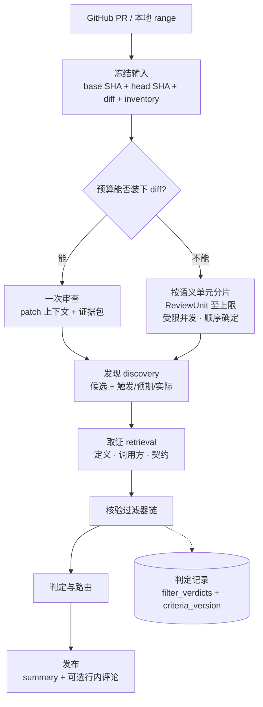
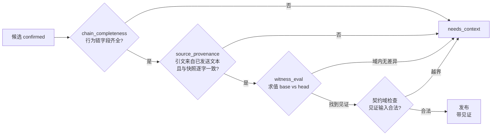
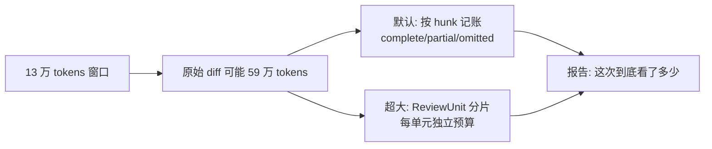
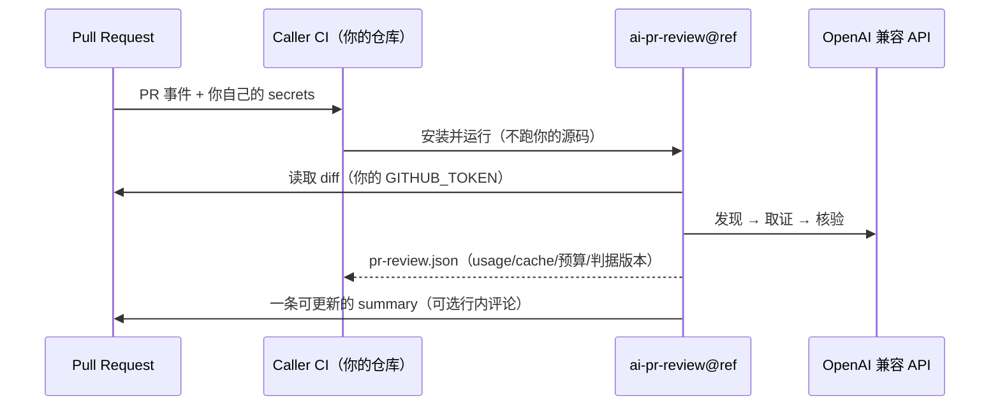
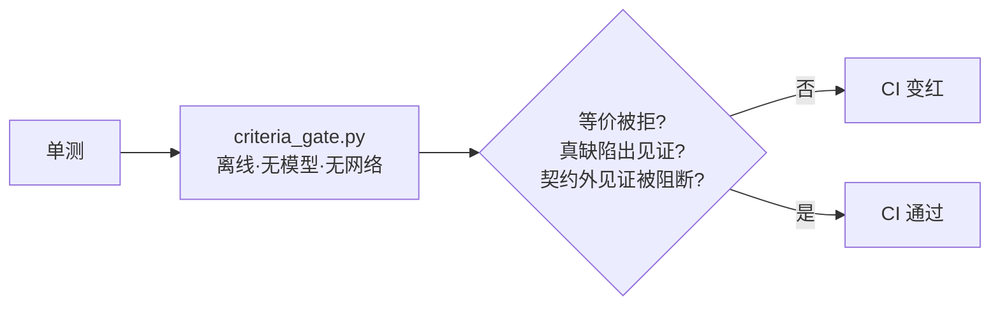

# AI PR Review

把 PR diff 变成**可追溯**的审查结论：发现候选 → 取证 → **机械核验** → 判定 → 发布。
本地优先，CI 用影子模式。**AI 辅助人工 Review，不替代人。**

- **规范**（唯一的）：[docs/HARNESS.md](docs/HARNESS.md)
- **我们强在哪、为什么**：[docs/ADVANTAGES.md](docs/ADVANTAGES.md)
- **开发过程记录**：[HANDOFF.md](HANDOFF.md)（非规范）

---

## 它怎么工作



### 核验过滤器链 —— 与"会读 diff 的模型"的根本差别



- `witness_eval` **实际求值**（AST 白名单、无 exec、域与步数预算）：**能证伪才发布**。
- 等价改写（`0<=i<n` ↔ `i<0 or i>=n`）在 32 个赋值上找不到见证 → **机械上无法 confirmed**。
- 见证若越出声明的契约域（如 `count:int` 却用 `None`）→ **不算见证**。
- 每条候选留下 `filter_verdicts`（过滤器名 + 通过与否 + 理由），报告带 `criteria_version`。

### 大 diff 怎么处理



---

## 快速开始（本地）

```bash
git clone https://github.com/HelicasECoode42/ai-pr-review.git && cd ai-pr-review
uv sync --extra dev

cat > .env <<'ENV'
OPENAI_API_KEY=sk-...
OPENAI_BASE_URL=https://api.deepseek.com/v1
REVIEW_MODEL=deepseek-v4-flash
GITHUB_TOKEN=ghp_...
ENV

uv run python -m src.cli.main OWNER/REPO 123 --output reports/pr-review.md
uv run python -m src.cli.main OWNER/REPO 123 --no-ai      # 只跑规则，不调模型
```

没有 API key 时**自动降级为规则模式**并在报告里说明，不会静默失败。

## 放进别人的 CI（reusable workflow）

```yaml
# .github/workflows/ai-review.yml —— 放在你的仓库
name: AI PR Review
on:
  pull_request:
    types: [opened, synchronize, reopened]
jobs:
  review:
    permissions:
      contents: read
      pull-requests: write
    uses: HelicasECoode42/ai-pr-review/.github/workflows/ai-pr-review-reusable.yml@main
    with:
      reviewer_ref: "<tag 或 40 位 SHA>"   # 建议固定版本
      language: auto
      post_inline: false                    # 默认只发一条可更新的 summary
      max_input_tokens: 6000
    secrets:
      OPENAI_API_KEY: ${{ secrets.OPENAI_API_KEY }}   # 用你自己的 key
```



---

## 输出

| 字段 | 含义 |
|---|---|
| `symbol` / `symbol_status` / `symbol_reason` | 属于哪个函数/类；取不到时**给理由**（`documentation`、`hunk_header_has_no_context`…） |
| `confidence` / `source` | 自报置信度与来源（`ai_behavior_verified` = 通过核验） |
| `evidence` | 原文引用（必须来自已发送文本） |
| `pending_suggestions` | 证据不足的候选（**保留可见，不静默丢弃**） |
| `metrics` | `usage_*`、`cache_hit_rate`、`witness_blocked_count`、`units_*`、`criteria_version`、`experience_ids` |
| `budget_report` / `omissions` | 每个切片的下场与原因 |

## 配置（常用）

| 变量 | 默认 | 说明 |
|---|---|---|
| `REVIEW_MODEL` / `CRITIC_MODEL` | — | 主审 / 对抗模型 |
| `ENABLE_CRITIC` | `true` | 对抗复核（第二个模型再跑一遍） |
| `PUBLISH_MIN_CONFIDENCE` | `0.80` | 行内评论阈值（盖章进报告，workflow 读取） |
| `REPOSITORY_EVIDENCE_TOKENS` | `6000` | 证据包预算 |
| `MAX_REVIEW_INPUT_TOKENS` | 空 | 整次运行输入上限（控成本） |
| `UNIT_REVIEW_MAX_UNITS` | `12` | 大 PR 分片上限（0 = 关闭） |
| `UNIT_REVIEW_WORKERS` | `4` | 单元并发（硬上限 8） |
| `PLAYBOOK_PATH` | `knowledge/playbook.md` | 知识层 |
| `PLAYBOOK_RECALL_K` | `5` | 每次召回条目数 |

---

## 部署方式

| 方式 | 命令 | 定位 |
|---|---|---|
| **本地 CLI**（主推） | `uv run python -m src.cli.main OWNER/REPO PR` | push 前自检；成本可控 |
| **CI 影子**（次推） | 上面的 reusable workflow，`post_inline: false` | 团队：一条 summary，不刷屏、不阻塞合并 |
| **一次性试用** | `uvx --from git+https://github.com/HelicasECoode42/ai-pr-review ai-pr-review OWNER/REPO PR` | 不安装 |
| **Web Console**（演示） | `uv run uvicorn src.service.app:app --port 8000` | 离线 Demo，**非对外承诺** |
| **容器** | `docker build -t ai-pr-review . && docker run --env-file .env ai-pr-review OWNER/REPO PR` | 隔离环境（Dockerfile 待补） |
| **VS Code 插件** | **已冻存，暂不支持** | 代码与 `.vsix` 保留 |

**安全**：`reviewer_ref` 决定在**你的 CI 里、用你的 secrets** 执行哪个远端版本 → **固定 tag 或 SHA**。diff 与证据摘录会发往 `OPENAI_BASE_URL`；用 `MAX_REVIEW_INPUT_TOKENS` 设上限。被审仓库内容一律视为**不可信数据**。

---

## 质量保障



- `pytest` — 317 个测试（判据链、证据来源、单元并发、playbook）
- `scripts/criteria_gate.py` — **判据回归门禁**，已进 CI，零成本
- `ruff --select E9,F63,F7,F82` — CI 门禁
- 真实评测：`scripts/gold_identification.py`、`scripts/agent_flow_identification.py`

## 已知边界（不藏）

- 没有 `run_tests` 沙箱（`witness_eval` 只覆盖纯表达式）
- 没有行内去重与驳回记忆（可能重复提出已驳回的问题）
- 没有采纳回路（不知道评论是否被处理）
- 真实评测集缺失（gold 集 4 例；历史 25 个 PR 已被接触过，不能当"未见测试"）
- RSI 循环未实现（机械门禁已就绪）
- legacy 一次性路径**保留为成对评测的对照组**，不作为用户可见模式

## 文档

| 文档 | 作用 |
|---|---|
| [docs/HARNESS.md](docs/HARNESS.md) | **唯一规范**：15 条硬性条款、现状、架构与判据、6 阶段计划 + RSI |
| [docs/ADVANTAGES.md](docs/ADVANTAGES.md) | 我们强在哪、为什么 |
| [docs/evaluation/identification-baseline.md](docs/evaluation/identification-baseline.md) | 错误识别基线：0.50 → 1.00 |
| [docs/graph-planning-dataflow.md](docs/graph-planning-dataflow.md) | 预算/覆盖/缓存实测 |
| [docs/error-handling-policy.md](docs/error-handling-policy.md) | 降级政策 |
| [docs/review-guide.md](docs/review-guide.md) | 使用与判据 |
| [docs/archive/](docs/archive/) | 历史文档（不维护） |
