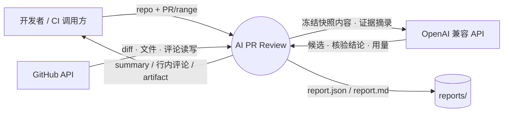
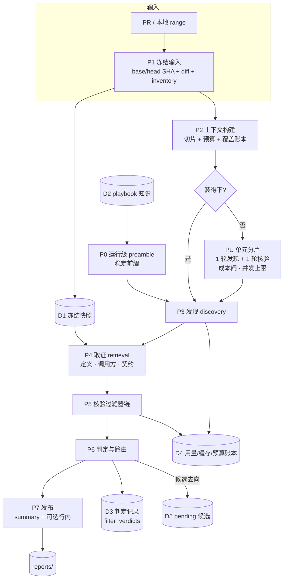
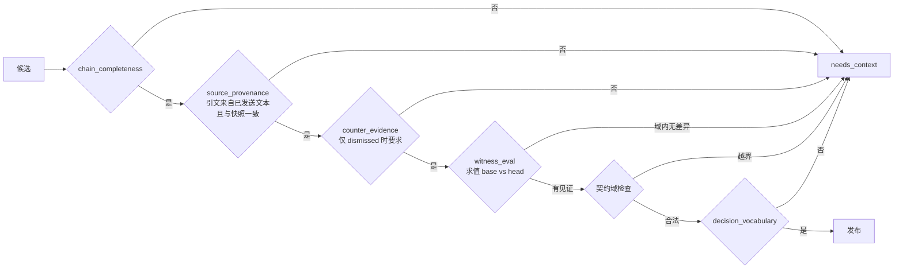
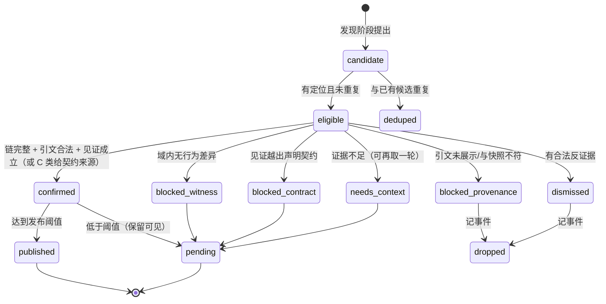
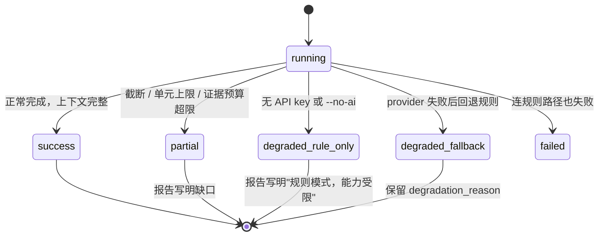
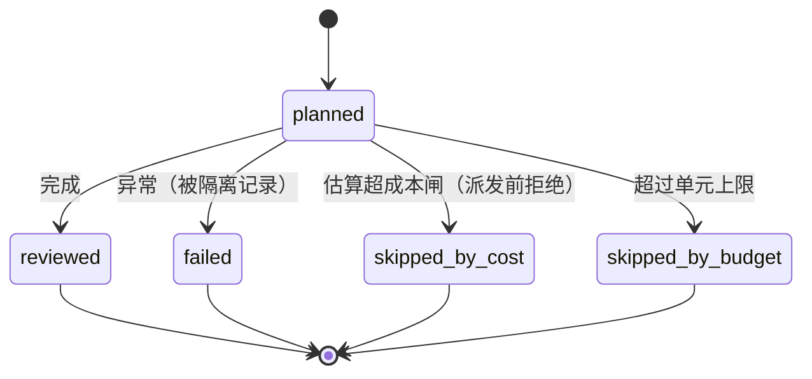

# 数据流（DFD）与状态转换（STD）

本文用图固定**所有功能的走向与状态**。任何功能都必须能在这两张图里指出位置；**图上没有的东西 = 不该存在**；**图上有但代码没接 = 接缝 bug**（由 `scripts/interface_audit.py` 在 CI 里查）。

---

## 1. DFD Level 0：系统上下文

**信任边界**：`GH` 回来的仓库内容、PR 文本一律是**不可信数据**；`LLM` 的话是**待核验主张**，不是事实。

---

## 2. DFD Level 1：主流程与数据存储

| 编号 | 功能 | 代码位置 | 账目 |
|---|---|---|---|
| P0 | 运行级 preamble（知识/不变量，稳定前缀） | `application/review.py` → `grounded_review.py` | `experience_ids` |
| P1 | 冻结输入 | `analyzer/git_loader.py`、`github/client.py` | SHA 进报告 |
| P2 | 切片 + 预算 + 覆盖账本 | `analyzer/review_plan.py`、`context_builder.py` | `ChunkCoverage`、`omissions` |
| P3 | 发现 | `reviewer/grounded_review.py::review_grounded` | `candidate_audit` |
| P4 | 取证 | `analyzer/repository_context.py::EvidenceBundle` | `excerpts/omitted/evicted` |
| P5 | 核验过滤器链 | `reviewer/criteria.py`、`reviewer/witness.py` | `filter_verdicts` |
| P6 | 判定与路由 | `grounded_review.py`、`reviewer/budget.py` | `behavior_verifications` |
| P7 | 发布 | `.github/workflows/ai-pr-review*.yml`、`output/` | 发布计数 |
| PU | 单元分片 | `reviewer/unit_review.py` | `units_*`、成本闸 |

---

## 3. DFD Level 2：核验过滤器链（唯一的"允许发布"路径）

**判据版本**：`CRITERIA_VERSION`（当前 `grounded-v3: chain+provenance+witness+contract`）。改判据必须能解释"哪些条目因此改判"。

---

## 4. STD：候选的生命周期

**不变式**：任何状态都必须能在 `filter_verdicts` / `candidate_audit` 里查到**原因**；没有"无声消失"。

---

## 5. STD：一次运行的结局

**不变式**：`execution_status` 与 `degradation_reason`、`analysis_warnings` 必须一致；**降级一律留痕**（H8）。

---

## 6. STD：单元（PU）的结局

---

## 7. 接缝检查（为什么需要它）

历史 bug **全部**是"层与层之间没接上"，而不是单层算错：

| bug | 形状 |
|---|---|
| `prompt_addendum` 没进 grounded | 上层赋值，下层从不读 |
| `min_confidence` 传了不用 | 同上 |
| `witness_blocked` 在分支内初始化 | 某条路径未定义 → 整次运行降级 |
| playbook 语言 `py` ≠ `python` | 两侧各自"正确"，语义不匹配 |
| `continue-on-error` 放在 job 级 | 顺带废掉了 `npm audit` 门禁 |

**机制**：`scripts/interface_audit.py` 静态检查三类接缝（未知关键字参数、惰性开关、收了不用的参数），已进 CI。**新增功能必须同时通过它与 `criteria_gate.py`。**

---

## 8. 图从哪来、怎么保证不脱节

**手画的图会漂移**——本项目已经踩过：图上写着"逐单元已接引擎"，实测只覆盖 9/146 单元；图上写着"playbook 注入"，而 grounded 路径根本没收到 `prompt_addendum`。

所以：

1. **清单与调用边由代码生成**：`scripts/module_map.py` 用 AST 产出每个模块的公开函数、调用的 src 模块、**触及的账目**、接缝参数 → [`module-map.generated.md`](module-map.generated.md)（**请勿手改**）。
2. **本文的 L2 与 STD 必须与 `src/reviewer/criteria.py` 的过滤器顺序逐字一致**；改判据必须同时改本文与 `CRITERIA_VERSION`。
3. **接缝由 CI 强制**：`scripts/interface_audit.py`（惰性开关 / 未知关键字 / 收了不用）+ `scripts/criteria_gate.py`（判据回归）。
4. **未接线的东西必须在这里标注**，不允许只在代码里悄悄存在。

## 9. 实现状态（诚实版，2026-10-16）

| 功能 | 状态 | 证据 |
|---|---|---|
| P1 冻结输入 | ✅ | 报告带 base/head SHA |
| P2 切片 + 覆盖账本 | ✅ | 187 文件实测 22/193 完整、omissions 逐条 |
| P3 发现 | ✅ | 真实运行 27 候选；合成集 2/2 命中 |
| P4 取证 | ⚠️ | 证据预算会用尽（`repository_evidence` 超限警告），真实运行 5/5 候选曾被扣 |
| P5 核验链 | ✅ | `witness_eval` 实际求值；等价改写机械阻断；契约域阻断 |
| P6 判定与路由 | ✅ | `filter_verdicts` 逐条可查 |
| P7 发布 | ⚠️ | 无行内去重、无驳回记忆 |
| PU 单元分片 | ⚠️ | 已接引擎、默认关闭、成本闸生效；实测覆盖 12/146，性价比未达标 |
| 缓存前缀 | ⚠️ | 规则已定（C1–C6）；运行级 preamble 已进 grounded；单元间共享前缀仍短 |
| 确定性工具先砍 | ❌ | 未接 linter / 类型 / 测试（**"能动手"的最大缺口**） |
| `witness_eval` 只覆盖纯表达式 | ⚠️ | `run_tests` 沙箱未做 |
| 采纳回路 | ❌ | 未采集"评论是否被处理" |
| RSI 循环 | ❌ | 门禁已机械，循环未实现 |
| 干净评测集 | ❌ | 仅 4 例合成 gold；历史 25 PR 已被接触 |
