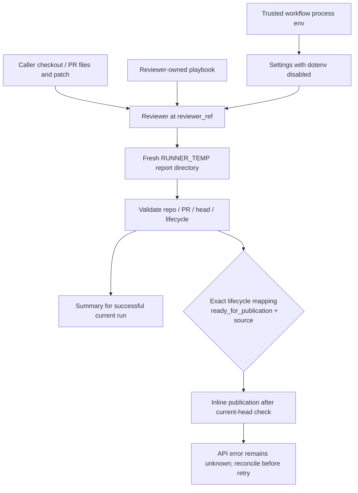

# Agent hardening iterations

## 1. Trusted CI configuration and publication gates

The reviewer workflow treats the checked-out PR tree as review input. A trusted CI
step sets `AI_PR_REVIEW_TRUSTED_CI` in the process environment before settings are
loaded. That mode skips dotenv loading; local runs continue to support `.env` and
custom provider endpoints. The reusable workflow checks out the reviewer source
at `reviewer_ref` and passes its playbook by absolute path. If that trusted file is
missing, knowledge recall is disabled with a warning instead of falling back to
the caller's `knowledge/playbook.md`.

Reusable callers should pin `reviewer_ref` to a reviewed tag or commit SHA. The
default remains `main` for compatibility and follows moving code, so it is not a
reproducible or immutable reviewer version. The self-review workflow still checks
out the PR base branch as the reviewer, preserving its existing isolation model.

Each run creates a fresh report directory below `RUNNER_TEMP`; report JSON,
Markdown, publication state, and the candidate ledger use that path. Upload and
summary steps read only those current-run paths. Summary publication requires a
successful reviewer step and a report whose repository, PR number, head SHA,
execution status, confidence, and lifecycle inventory match the current PR. A
partial report can still be summarized with its degraded status visible. Inline
publication additionally requires an exact suggestion-to-candidate mapping,
`ready_for_publication`, a usable source on the actual suggestion, and a current
PR head match. An unmapped suggestion or `rule_unverified` source is withheld.
After a comment API error, the outcome remains unknown; a later run must inspect
existing fingerprint comments before attempting another write.

Validation for this iteration uses local fake dotenv/config fixtures, lifecycle
gate fixtures, workflow syntax checks, Ruff, and whitespace/diff checks. It does
not use API credentials or perform GitHub writes.

## 2. Offline acceptance after provider ownership fixes (2026-10-26)

The earlier full run reported 671 passed and 2 failed, including the stale
same-model provider reuse assertion. That assertion conflicted with the critic's
independent output-token cap. The application now creates separate review and
critic providers when critic mode is enabled, keeps their request budget shared,
and closes each unique provider object once. The final full suite passed **678
tests** (`.venv/bin/python -m pytest -q`; fake API key and localhost endpoint
were set), with one Starlette/httpx deprecation warning. The earlier two failures
did not recur.

The CI minimum Ruff selection, criteria gate, interface audit, criteria holdout,
Node publication gate, and `git diff --check` all passed. The interface audit
still reports five accepted-but-unused parameters; it reports no inert flags or
call/definition mismatches. The criteria holdout is a deterministic regression
set, not a fresh independent PR holdout. No model/API requests or GitHub writes
were made. This run establishes offline test and gate status only; real-model
precision, recall, and PR-level review quality remain unmeasured.

## 3. Offline acceptance after identity and cleanup fixes (2026-10-27)

The frozen revision passed the full `.venv/bin/pytest -q` suite: **680 passed**
in 40.54s. The command used a fake `OPENAI_API_KEY` and localhost-only provider
URLs (`127.0.0.1:9`); no paid provider or GitHub endpoint was contacted. Pytest
reported one existing `StarletteDeprecationWarning` about `httpx` in
`fastapi.testclient`.

The CI minimum Ruff selection passed. `criteria_gate.py` passed all 4 cases;
`holdout_eval.py` passed 14/14 cases (7 equivalence cases and 7 behavior-change
witness cases). `interface_audit.py` audited 89 files and passed with zero call /
definition mismatches and zero inert flags. It still prints four accepted-but-
unused parameter notices: `ReviewMerger.merge` (`independent_suggestions`,
`signals`, and `verification`) and `two_stage_review(findings)`. These are
informational under the audit's current gate. The Node publication gate passed
4/4 tests. All three workflow YAML files parsed, and the four embedded
`actions/github-script` blocks in the two review workflows passed Node syntax
checks. `git diff --check` passed.

This is offline test and static-gate evidence only; no live provider quality,
GitHub publication, or remote workflow execution was exercised.
