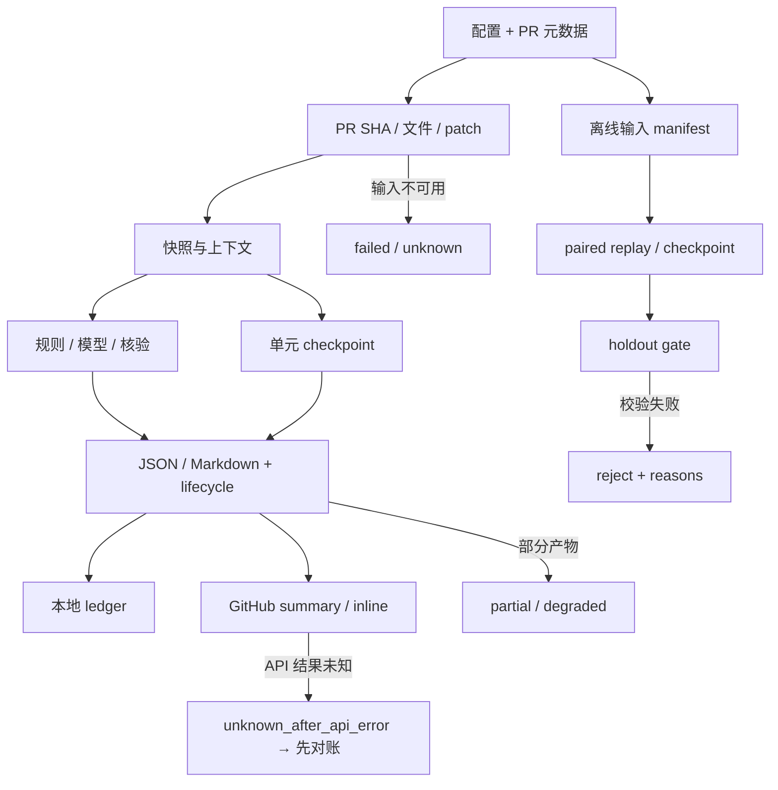

# 端到端故障恢复矩阵

本文按一次审查与一次离线评测的实际数据路径，说明遇到故障先看什么、哪些结果可以恢复，以及当前证据边界。表中“已实现”只指代码中可观察到的处理；“部分”表示覆盖不完整；“缺口”表示没有相应保证。`complete` 只说明特定产物/清单完整，不代表已证明无缺陷。

| 阶段与代码位置 | 具体故障 | 首先检查 | 恢复与兜底 | 当前实现与缺口 | 离线验收 |
|---|---|---|---|---|---|
| 配置与信任边界：`src/utils/config.py`、`.github/workflows/ai-pr-review-reusable.yml` | 空的 workflow `OPENAI_BASE_URL` env 被忽略后，caller checkout 的 `.env` 可能改 endpoint/预算；若该 run 同时有 API key，PR diff/证据会送到其配置地址 | 实际 `openai_base_url`、配置值来自 process env 还是 `.env`、`MAX_INPUT_TOKEN_UPPER_BOUND`/预算、workflow secrets 和 endpoint | 可信 CI 对 endpoint 与预算使用显式受控配置；拒绝不在批准列表的 endpoint 并停止模型调用。保留本机自定义 provider 能力 | **部分（条件风险）。** `SettingsConfigDict(env_file=".env", env_ignore_empty=True)` 允许 dotenv 作为空 env 的 fallback；workflow 注释只保护 durable write 路径，未清除 caller `.env` 对其他设置的影响；无 endpoint allowlist | 在隔离 runner 中给 `.env` 配置另一 endpoint/预算且 workflow secret 留空；确认生产配置不会读取它，批准配置和本地自定义配置仍分别工作 |
| Playbook 信任：`src/utils/config.py`、`src/knowledge/playbook.py`、`src/reviewer/engine.py` | caller checkout 的 `knowledge/playbook.md` 声明 `status: authoritative` 后参与 prompt，PR 可自行把候选规则提升为权威知识 | `playbook_path`、entry `id/status/scope/source`、实际传入 prompt 的 recalled entries、reviewer ref | CI 仅从可信 reviewer ref 加载已审核 playbook，或拒绝 PR 工作树的 `authoritative` 条目；候选知识留作候选，不能自我授权 | **缺口（信任根错位）。** `status` 来自 Markdown frontmatter 并由 loader 接受；默认相对路径指向当前工作目录，缺少独立可信来源签名/授权机制 | 构造 PR 修改 playbook 将 `candidate` 改为 `authoritative`；确认可信 CI 不把它加入 prompt，local opt-in 文件路径行为单独验证 |
| Web 报告渲染：`src/service/static/app.js` | PR/模型报告的 Markdown 含 HTML 脚本片段，经解析后进入 DOM，可能触发 XSS | `/api/analyze` 返回的 Markdown 内容、`marked.parse()` 结果、目标 DOM 节点 | 把报告内容视为不可信输入；渲染前使用 HTML sanitizer，或关闭原始 HTML 并对文本节点编码 | **缺口（静态发现）。** `marked.parse(md)` 结果直接赋给 `innerHTML`；未发现 sanitizer。报告内容可包含 PR/模型控制文本 | 用 `` 等本地 fixture 检查渲染 DOM；验收不产生可执行元素/事件属性 |
| PR 元数据/文件获取：`src/github/client.py`、`src/agent/runner.py` | 401、403、429、5xx、超时、分页中断，或 changed-files 读取失败 | HTTP 状态/异常类型、`AgentStep.status/error`、`state.warnings`、文件数、completeness | 同一 PR 的只读 GET 可有限重试；权限/404 先修配置；429 先看 Retry-After/rate limit；失败的文件集不得解释成“没有问题” | **部分。** API 错误有分类；403 中权限与限流、429 与通用错误未完全区分。Runner 对 changed-files 失败会 warning 后继续空 `ctx.files`，需确保最终 report 是 partial/failed | Mock 401/403/429/5xx 和第二页中断；验证警告/失败步骤可见，报告不能呈现为完整且无发现 |
| 冻结输入：`src/github/client.py`、`src/agent/runner.py` | PR 在读元数据与分页 changed files 之间更新，head SHA 与 patch 可能来自不同版本 | `base_sha/head_sha`、文件 patch、report input identity、分页前后 head | 绑定 `{repo, PR, base_sha, head_sha}`；读取前后 SHA 不一致则重取固定 SHA 输入或标 partial，不混用 | **缺口。** PR SHA 与按 PR number 获取的 changed-files 分两步读取，未发现末尾 SHA 复核；后续 snapshot 固定 SHA 读源码不能修正已混入的 patch | Mock 分页期间 head A→B；验证该次输入不标为完整，也不会将 B 的 patch 记到 A 的身份 |
| 仓库快照：`src/analyzer/repository_context.py` | 路径越界、错误 side、缺失 SHA、内容超限、GitHub 读取失败或搜索被截断 | `Snapshot.read()` 返回值、`audit()` 中 `search_limited`、`read_files[{side,path,available}]`、`errors[{reason,path,side,symbol}]` | 对同 SHA/side/path 的暂时读错有限重试；unsafe path、binary/超限/unsupported 不扩大限制，保留 omissions/partial | **已实现（有界）/部分。** 拒绝绝对路径和 `..`，按 SHA/side 缓存并记录可读性/错误；搜索有上限。调用端仍须结合 audit/coverage 区分空结果与完整搜索 | 用 fixture 覆盖 base/head 隔离、坏 tree、unsafe path、搜索超限；确认 audit/errors 不被解释成无命中 |
| Diff 与上下文：`src/analyzer/diff_parser.py`、`src/analyzer/context_builder.py` | patch 缺失、截断、格式错误或解析后无 hunk | file status、patch 是否缺失、解析 hunk 数、`Omission.reason`、`ReviewContext.coverage/coverage_summary` | 同一固定 SHA 有界补读；补不到则保留 omission/partial，不把空 hunk 当成无变更 | **部分。** 缺 patch 会尝试从冻结 ref 补整文件，失败时记录 omission；坏 patch 可记 `patch_without_hunks`。部分解析警告未贯穿所有调用端 | 用缺 patch、malformed patch、无 SHA 的 fixture；报告要显示具体 omission 且不称完整 |
| 上下文源码 side：`src/analyzer/context_builder.py` | 截断 hunk 读不到 head 时回退到 base，prompt 可能把旧源码当成当前源码 | `substituted_reason`、读取 side/SHA、最终 prompt 代码块 | 标明 `base` 来源，或不注入旧源码而显示 omission；禁止只按路径缓存两侧源码 | **部分（静态发现的风险）。** 有 head→base 回退；替代文件块无 side/SHA 标签，`Omission` 只记录替换原因/行数，存在把旧源码当当前源码的风险；是否导致具体建议错误需单独离线验收 | 构造 head 读取失败、base 可读的截断 hunk；验收 prompt 明示 base side 或仅保留 omission |
| 索引/证据预算：`src/reviewer/grounded_review.py`、`src/analyzer/repository_context.py`、`src/utils/config.py` | 索引 partial、语言 parser 不支持、证据被省略/驱逐或预算耗尽 | parser limitations、partial 标记、`omissions/evicted`、最终 evidence refs、token/字节预算 | 同一快照只做有界读取；索引只作定位线索。增预算视作新运行，不能静默把不完整证据改称完整 | **已实现（显式降级）/功能受限。** Python 索引有文件/字节预算并记录 partial；不支持语言有 limitation；EvidenceBundle 记录 omission/eviction；索引默认关闭且不能证明根因 | 用已有 fixture 验证 partial、坏 schema 回退、词法命中保留和预算 omission；不需要本次重跑全测 |
| Agent 工具步骤：`src/agent/runner.py`、`src/agent/state.py` | 单个工具抛错、结果未设置、上游空输入被下游继续使用 | 每个 `AgentStep` 的 tool/status/error/duration、`degradation_path`、warnings、最后报告 confidence | 区分失败、跳过、部分成功；依赖缺失时阻断下游或明确生成 partial 报告，不能把空集合当成功 | **部分。** Runner 记录步骤和降级路径；changed-files 失败可能继续空集。结果终态需以报告 completeness/confidence 为准 | Fake registry 让 fetch 或 scan 失败；验证 state 记录原工具错误，最终结果不报 success/normal |
| 取消与 Web SSE：`src/service/app.py`、`src/agent/runner.py`、`src/reviewer/unit_review.py` | 浏览器断开、CLI 取消或 worker 被中断时模型请求仍在跑 | SSE 最后事件、worker 状态、unit `cancelled`、已有 checkpoint、已发送请求数 | 传播取消信号；已发送请求仍记费用/结果未知，checkpoint 后只恢复身份匹配的单元 | **缺口/部分。** unit primitive 有 cancellation Event，但生产 engine 未传入；SSE 后台线程未发现断开检测/取消链。浏览器断开不等于审查已停 | 长时 fake provider 后断开 SSE；验收取消传播，或显式标运行继续/费用未知，不能发 `complete` |
| 模型请求：`src/reviewer/provider.py`、`src/reviewer/budget.py`、`src/utils/config.py` | 401/402/429/5xx、连接/读错误、timeout；服务端可能已处理但客户端没收到响应 | error kind/status、attempt count、共享 deadline/输入字节预算、若成功记录则查 request id、usage 状态 | 遵守 attempt/deadline 上限；401/402 不应重试，429/5xx/timeout 也先确认当前重试策略与远端结果。timeout/断流不假设 provider 未执行，不承诺 exactly-once 或无重复费用 | **部分。** 有共享 attempt、字节估算与 deadline；一般没有 provider 重试，response_format 不支持时有一次兼容重试。402 分类较粗；已发请求失败可能重复收费 | 假 provider 在接收请求后断连接；确认重试次数受限、费用状态不写成零/确定 |
| 流式响应与 usage：`src/reviewer/provider.py`、`src/reviewer/usage.py` | 流式断流或 timeout，response/usage 未完整落到 audit | stream 是否完整、attempt、request id、usage known/unknown、report degradation | 标记 usage unknown；不要因无 usage row 认定免费。相同输入的人工重试需先对账服务端账单/请求日志 | **部分。** 完整流结束后才记录 usage；中途断流可能没有 usage record，审计汇总不能从缺记录推断无费用 | Fake stream 在服务端接收后断流；验证 usage 显示 unknown/缺失原因，不显示零费用 |
| 模型结构化输出：`src/reviewer/model_payload.py`、`src/reviewer/grounded_review.py`、`src/reviewer/engine.py` | 非法 JSON、重复/未知 candidate ID、证据引用无法核验、预算超限 | parse errors、candidate ID、`candidate_audit`、filter verdict/reason、预算 omissions | 纠错请求也计入预算；非法/重复 ID 拒绝或保留 unverified/needs_context；不可扩大预算或把空输出解释为无发现 | **部分。** 有有限修复/重试、ID 校验、证据过滤、预算 omission；engine 可退化为 rule-only。应保持降级状态可见 | 离线 fake provider 返回非法 JSON/重复 ID/超预算；验证候选拒绝、原因与预算字段可追踪 |
| 报告写盘：`src/cli/main.py`、`src/output/json_report.py` | Markdown/JSON 目录权限、磁盘满、进程中断导致报告缺失或半写 | `--output` 路径、JSON/Markdown 两个产物是否存在、write exception、报告执行状态 | 先保留错误日志与已有完整报告；写失败不可默认为成功；恢复时写新 run 路径，避免覆盖唯一证据 | **部分。** CLI 创建父目录并直写报告文件；未发现通用 temp+rename 原子写。GitHub workflow 会警告缺 artifact，但 summary 步骤软失败 | 用只读/失效路径模拟写失败；验证退出/告警非 success，并且不产生误导性的空报告 |
| 报告降级与 Step Summary：`src/cli/main.py`、`src/models.py` | provider/分析失败仍有规则报告；GHA summary 写入失败或缺报告 | `execution_status`、`report_confidence`、`degradation_reason`、`analysis_warnings`、Step Summary 输出 | 规则回退可以交付诊断，但必须保留 partial/fallback 语义；summary 缺失时回看 artifact JSON/运行日志 | **部分/已有保护。** step-summary 写失败会 console warning，且有报告时加入 `analysis_warnings`；状态字段支持 `success/degraded`、`normal/fallback/partial/failed` | Mock provider 与 `GITHUB_STEP_SUMMARY` 写失败；确认报告保留降级 warning，不能把失败提示当作 clean result |
| Candidate lifecycle 发布资格：`src/reviewer/decision_ledger.py`、`.github/workflows/ai-pr-review.yml`、`.github/workflows/ai-pr-review-reusable.yml` | rule-only / AI fallback 的 `rule_unverified` 高置信候选越过 inline 门 | suggestion `source`、`candidate_lifecycle`、`suggestion_candidate_ids`、`lifecycle_status/reason_code`、AI 状态 | 发布端逐条映射 candidate，只允许生命周期 `ready_for_publication` 的项；不要按置信度/行号 alone 代替验证 | **缺口（可达）。** workflow inline 主要按 confidence/line 筛选；self workflow 还将来源写为 `AI`。`rule_unverified` 可在 API 缺失/fallback 时出现，workflow 未按 lifecycle 拦截 | 离线构造高置信 `rule_unverified` 建议，运行发布门函数；必须被阻断且保留 reason，不调用 GitHub API |
| 本地决策记录：`src/application/review.py`、`src/reviewer/decision_ledger.py`、`src/reviewer/publish.py` | decision ledger append 权限失败/磁盘错误/JSONL torn，或 dismissal 尾行损坏/写失败 | `candidate_ledger_persistence_status`、`execution_status`、`report_confidence`、run `candidate_count/append_status`、fingerprint、`DismissalStore` 路径 | 先备份原文件并保留全部原始字节；只对账/修复副本，不自动截断或覆盖 ledger/dismissal。恢复可新建后续 run | **已实现降级/部分。** candidate ledger 写失败会把报告标 degraded/partial；读取跳过坏行并给 run 标 `append_status=incomplete`。Dismissal loader 也跳过坏 JSON 行，但 append 错误可传播。尾损坏后的拒绝记忆不应假定已持久化 | 注入 append/OSError 和 torn 尾行；确认原文件字节不变，candidate 报告 partial、ledger run incomplete，dismissal 不伪称已保存 |
| Provider cleanup：`src/application/review.py`、`src/reviewer/engine.py` | 主 provider `close()` 异常遮蔽已经生成的报告，重跑可能再次付费 | 已有 report、ledger persistence、provider close exception、request usage | 保留已有报告并附 cleanup warning；先判断请求结果再决定是否重跑 | **条件风险。** ReviewApplication 的 ExitStack close 错误可能传播并遮蔽结果；unit provider 有吞 cleanup 异常保留结果的保护。尚未验证常规环境稳定触发 | Fake provider 在生成报告后让 close 抛错；确认 report 仍返回/落盘且附 warning，不重复请求 |
| GitHub summary 发布：`.github/workflows/ai-pr-review-reusable.yml` | `if: always()` 在主审查失败后仍读取 checkout 中预置的 `reports/pr-review.json` 并发 summary；文件可由 PR 控制，且 summary 未核验 repo/PR/head identity；另有 API 超时/权限失败 | 报告来源和 run identity：repo/PR/head/criteria、review step conclusion、文件生成时间/内容、marker comment、API status/error | 仅发布本次成功生成且 repo/PR/head identity 匹配的报告；运行前隔离或清理未受信任输入的预置路径。API timeout 先查询远端 marker/comment 再重试 | **缺口 + 部分。** summary 步骤 `always()+continue-on-error`，从固定路径直接读 JSON；没有检查报告身份，主步骤失败仍可能发布 caller 预置报告。缺失报告仅 warning；API/JSON 故障也会软失败，job 不一定失败 | PR fixture 预置别的 PR/head 报告并让 reviewer step 在写报告前失败；验收 summary 不发布。另模拟 API 成功后 timeout，重跑先对账 |
| GitHub inline 发布：两个 workflow 的 inline step | stale head、403/429、API timeout 后实际已发评论但响应丢失、publication artifact 写失败 | `{repo, PR, head, criteria}`、fingerprint marker、每候选 status、当前 head、远端 review comments | 先读当前 head 与 fingerprint 评论；只对远端确认不存在且 head 未变的候选补发。未知状态不能盲重发 | **部分。** reusable workflow 记录 `partial/stale_head/unavailable/complete` 和 `unknown_after_api_error`，使用 fingerprint 和 head 检查；read-before-write 不是跨 API exactly-once。self workflow 保护较弱；publication 状态 artifact 写盘失败可能丢证据 | Fake API 模拟请求成功但响应 timeout、403/429、head 更新；重跑先 reconcile，不生成重复评论；确认 artifact 保存每候选状态 |
| GHA artifact 上传：两个 workflow 的 upload-artifact step | 报告/ledger/publication 文件缺失或上传失败/过期 | artifact 名称/保留期、上传 step conclusion、文件清单、summary/report identities | 从 runner 本地报告和 workflow 日志恢复；下轮重新运行需保存原 run ID 与 SHA，避免拿最新报告冒充旧运行 | **部分。** self workflow 上传报告并设 30 天；reusable workflow 最后上传 report/publication/ledger；保留期与产物丢失后的人工找回流程依赖 GitHub | Mock 缺文件并检查 warning；比对上传文件身份与 PR head，不能仅凭 artifact 名称认定匹配 |
| 单元审查 checkpoint：`src/reviewer/unit_review.py`、`src/reviewer/engine.py` | checkpoint lock 忙/不可用、文件损坏/身份不符、响应后写 artifact/metadata 失败 | unit status (`checkpoint_failed/busy/unavailable/unsupported`)、`checkpoint_issues`、run identity hash、artifact SHA/typed result | 只 resume 同一 run/base/head/unit/slice hash 且 artifact 验证通过的 unit；锁忙时稍后同一身份重试。请求已送达但 checkpoint 未落盘时费用/结果可能未知 | **部分（已有本地恢复）。** unit checkpoint 有身份 hash、typed artifact/hash 与本地进程锁；有明确 `checkpoint_failed` 等状态。模型响应至双文件持久化间仍可能重复付费 | 用损坏 artifact、锁占用和“provider 已响应后写 checkpoint 失败”fake；验证错误状态可见，不错误 resume，重试费用标不确定 |
| paired 离线评测：`src/evaluation/paired.py`、`src/evaluation/corpus.py` | 硬中断发生在 provider send 与下一 run.json checkpoint 之间；继续运行可能重复调用 | `protocol.json`、arm `run.json`、case/arm status、HTTP budget snapshot、attempt/usage、input hashes | 同身份下恢复已成功 case；对未确认请求标 uncertain、先对账 provider 用量。不要仅凭 checkpoint 快照断言未扣费 | **部分。** protocol/source/model/budget 不匹配会拒绝混续；JSON checkpoint 使用 temp+replace。代码明确承认 send→checkpoint 窗口不可观察。输入清单绑定 prepared artifact/split registry/metadata/diff；replay 另绑定 candidate policy 与 `effective_policy_sha256`、protocol、criteria/runtime fingerprints。是否需要独立的 input-preparation-policy hash 需先定义审计要求，不据此断言现有输入 hash 缺失 | fake hard-stop 落在 send/checkpoint 间；确认恢复不会把未知调用记成零 attempts/零成本；改 prepared 内容会触发 input hash 不匹配 |
| Holdout 与评测 gate：`src/evaluation/improvement.py` | holdout 曾被候选设计泄露、attestation 不实、清单/策略/source identity 不匹配、gate 拒绝，或 pointer/event 只有一侧写成 | split registry/hash、`input_set_sha256`、`protocol_fingerprint`、candidate/policy/runtime/criteria SHA、consumed receipts、`gate.decision/reasons`、`active.json`、`events.jsonl` | 失败时保持 `reject`，查明具体 reason 并使用新的独立输入/授权；promotion/rollback event 写失败时按 pointer 与不可变版本 reconcile，不重放操作 | **部分（fail-closed）。** manifest/input、candidate policy、protocol/runtime/criteria 和消费回执均绑定；gate 记录 reject reasons。人工 holdout attestation 不能自动证明未泄露。active pointer 与 event 不是一个文件事务，event 失败会显式要求 reconcile；拒绝 gate 未统一追加历史事件 | 对重复 repository、holdout overlap、missing receipt、hash mismatch 和人工 attestation 负例离线跑 gate；另模拟 pointer 成功/event 失败，验证报错和 reconcile 依据 |
| 评测产物生命周期：`src/evaluation/reviewbench.py`、`src/evaluation/corpus.py` | 复用同一个 RB 输出路径时，旧 output/audit 先被删除，新运行随后输入/provider 失败；或审计文件直接写入中断 | output/audit 路径、run identity、prepared manifest、audit/report hash、文件 mtime/内容 | 每轮使用新 run 目录；旧证据先归档并校验 hash 后再清理。不可把缺失产物当作失败样本之外的“无数据” | **部分。** ReviewBench 明确 unlink 同名旧 output/audit，再运行 provider；output JSON 后续 temp+replace，audit 直接写。corpus JSON helper temp+replace。风险限于复用同路径的运行和直接写入中断 | 以既有输出路径启动 fake provider 前置失败；确认生产流程使用新 run 目录、旧证据归档可读，且不删除历史报告 |

建议按以下顺序修复：

1. **安全配置与发布门优先。** 给可信 CI endpoint 增加明确允许列表；发布端逐条要求 lifecycle `ready_for_publication`，并保留 `rule_unverified` 来源；统一 summary/inline 的失败结论和 unknown 后对账路径。
2. **成本与异常恢复。** 区分“请求未发出”和“远端结果未知”；保留 provider cleanup 后已生成报告；完善同身份 checkpoint resume、usage unknown、ledger 失败/尾损坏标记。
3. **评测证据保留。** 每轮新建输出目录，保留 manifest/replay/gate/reasons 和原始报告；在 prepared content hashes 外记录输入准备策略身份；holdout 污染保持 fail-closed，并让人工 attestation 可追溯。

建议是当前单机 Python/本地文件设计的局部恢复改进；它们不代表数据库事务、消息队列或跨系统 exactly-once 能力已经存在。
