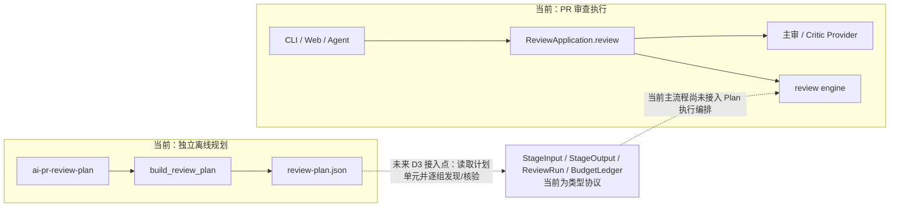

# 离线 Graph Planning 数据流

本文描述 `ai-pr-review-plan` 当前实际执行的数据流，以及它与现有 PR Review 执行链之间的边界。图规划是独立离线入口：读取固定 Git base/head 的差异和源码快照，生成 JSON 计划；它不调用模型，也没有接入 CLI/Web/Agent 的审查执行。

## 当前实现


`MemorySnapshot` 是测试中实现的轻量替身，遵循相同的 `read(path, side="head") -> str | None` 读取约定；生产 CLI 使用 `GitSnapshot`，将 `repo_path` 与固定 SHA 绑定并读取 Git objects，不读取 checkout 中尚未提交的工作区内容。

## 数据与接口

| 接口/数据 | 关键输入 | 返回/字段 | 当前含义 |
|---|---|---|---|
| `GitSnapshot(root: Path, base: str, head: str)` | 本地仓库路径和两个不可变 40 位 SHA | `read(path: str, side: str = "head") -> str \| None` | `side` 仅接受 `head`/`base`；读取对应 Git object，拒绝不安全路径、缺失对象或超限文件。 |
| `Snapshot` protocol | `base`、`head`；`read(path, side)` | 另声明 `search(symbol, side, limit)`、`audit()` | 图规划实际读取源码依赖 `read`；规划函数不调用 protocol 上的 `search`/`audit`。 |
| `ChangedFile` | `filename`、`status`、`patch`、可选 `previous_filename` | 传给 `parse_file_hunks(file)` | CLI 通过 `git diff --no-renames` 生成；因此 CLI 重命名表现为删除/新增。库接口可接收 `previous_filename`。 |
| `DiffHunk` | `ChangedFile.patch` 中的 unified diff hunk | `old_start/count`、`new_start/count`、`added_lines`、`removed_lines`、`raw` | `raw` 保留 hunk 内容，供后续按预算拆片。 |
| `SourceIndexCache.parse(path, text, side)` | 路径、源码文本、快照侧 | `SourceFile` | 有界的单次运行缓存，键为 `(path, side, sha256(text))`；不缓存模型结论。 |
| `SourceFile` / `SourceSymbol` | Python AST 或 TS/TSX Tree-sitter 解析 | 文件哈希、解析器名、定义名与行范围、导入、语法调用及限制 | 对其他语言标记 `unavailable`；TS 不解析类型。`SourceSymbol` 用于按 hunk 行范围定位相关定义并生成 `EvidenceRef`。 |
| `Relationship` | 源文件路径、目标文件路径、关系类型 | `source`, `target`, `kind`, `strength`, 可选 `symbol` | 图节点是**文件路径**，当前是文件级依赖/引用图，不是函数级调用图。唯一解析目标的本地 import 为 strong；多个候选为 weak；按同名调用/定义匹配得到的 `symbol_reference` 始终是 weak。 |
| `ChangeSlice` | 一个 `DiffHunk` 与其片段序号 | `hunk_id`, `hunk_index`, `fragment_index`, `fragment`, `symbols`, `evidence`, `estimated_tokens` | 超预算 hunk 分片；索引从 0 开始。`hunk_id` 绑定文件、hunk 序号与原始文本。 |
| `EvidenceRef` | 相关定义源码 | `path`, `side`, `start`, `end`, `content_hash` | 只保存延迟读取引用，不把定义文本本身计入当前 diff token 预算。 |
| `ReviewUnit` | 被分到同一组的 slices | `unit_id`, `slices`, `estimated_tokens`, `evidence`, `related_paths` | 单元估算基于拼接后的 diff fragments；相关文件可包括强弱关系边上的邻居。 |
| `ReviewPlan` | 固定 base/head、预算及组装结果 | `units`, `files`, `relationships`, `coverage`, `limitations` | `version="syntax-plan-v1"`；JSON 是规划产物，不是审查报告。 |

入口签名为 `build_review_plan(snapshot, files, paths, *, token_budget=6000, index_file_limit=5000, index_char_limit=20_000_000, public_degree=8, index_cache=None) -> ReviewPlan`。当前 `token_budget` 只约束分组后拼接的 diff fragment tokens；系统提示、`EvidenceRef` 指向的定义源码及模型输出不在这个预算里。计划会记录 `evidence_refs_are_lazy_and_not_in_diff_token_budget`。

分组只沿 strong relationship 的无向邻接扩展。这里的节点是文件路径；strong 表示 import 在给定路径 inventory 中解析到唯一文件，不等于已证明运行时调用。弱引用不驱动合并，但会进入 `related_paths`。遍历受 `token_budget` 和 `public_degree` 限制；高连接节点可作为相关证据，不会强制把所有消费者合成一个超大单元。这是语法级启发式边界，不是函数级语义调用图或最优分组证明。

## 与主审查链的边界



`ReviewApplication` 目前负责模型 Provider 生命周期、Critic Provider 和冻结仓库 reader 的所有权；`protocol.py` 定义 `ReviewRun`、`StageInput`、`StageOutput`、`BudgetLedger` 等类型。仓库中只有 `src/cli/plan.py` 调用 `build_review_plan`，主审查入口没有读取 `ReviewPlan` 或逐 `ReviewUnit` 调度。图中的虚线是 D3 的未来连接点，不表示已有队列、恢复、LLM 分组调用或发布流程。

## 离线样例：输入到分组结果

使用内存快照运行 `build_review_plan`，输入包含一个 Python import 链、一个无关 Python 模块和一对 TS 接口文件。下面分别是实际运行使用的合法 base/head 源码；`ChangedFile.patch` 由每对源码的 unified diff 生成，因此 hunk 与快照内容一致。预算为 6,000 tokens。

```json
{"base": {
  "app.py": "from service import run\ndef endpoint():\n    return 0\n",
  "service.py": "def run():\n    return 0\n",
  "standalone.py": "def unrelated():\n    return 6\n",
  "api.ts": "import { User } from './types.js';\nexport function show(u: User) { return u.name; }\n",
  "types.ts": "export interface User { id: number; name: string }\n"
}, "head": {
  "app.py": "from service import run\ndef endpoint():\n    return run()\n",
  "service.py": "def run():\n    return 1\n",
  "standalone.py": "def unrelated():\n    return 7\n",
  "api.ts": "import { User } from './types.js';\nexport function show(u: User) { return u.id; }\n",
  "types.ts": "export interface User { id: string }\n"
}}
```

每个单文件源码都作为独立文件文本传给 `MemorySnapshot`。运行脚本按 `sorted(head)` 遍历路径，为每一对 base/head 文本执行 `difflib.unified_diff(base[path].splitlines(), head[path].splitlines(), fromfile="a/" + path, tofile="b/" + path)`，把结果以换行连接后传入 `ChangedFile(filename=path, status=FileStatus.MODIFIED, patch=patch)`；再调用 `build_review_plan(MemorySnapshot(base, head), files, list(head), token_budget=6000)`。因此示例中的 hunk 是与快照一致的本地 fixture diff，不是任意拼造、也不是实际仓库提交的 patch。

实际离线运行得到的关键结果：

```text
relationships:
  api.ts -> types.ts       import            strong
  app.py -> service.py     import            strong
  app.py -> service.py     symbol_reference  weak (symbol=run)

units:
  [api.ts, types.ts]       75 estimated diff tokens
  [app.py, service.py]     55 estimated diff tokens
  [standalone.py]          25 estimated diff tokens

slices: 5 hunks → 5 slices; each slice has hunk_index=0, fragment_index=0
coverage: all 5 input paths are planned
limitations: evidence_refs_are_lazy_and_not_in_diff_token_budget
```

这说明给定这组语法输入时，唯一解析的 import 边让文件进入同一个单元；独立文件保持单独。它只验证这一组输入到输出的可解释映射，不证明语义分组普遍正确、最佳或提升审查质量。

## 验证记录与边界

- 当前代码记录的全量测试结果为 **181 passed**；行为覆盖包括确定性分组、循环依赖、公共高连接节点、文件覆盖、hunk 分片、删除/重命名证据、TS 导入、缓存和不读取未提交工作区内容。
- 固定真实仓库范围 `89943fe → 13e9a3e`，`token_budget=1000` 时生成 **22 hunks、14 units**，最大单元 **986 estimated diff tokens**；索引中有 **238 条 import relationship** 与 **970 条 weak symbol-reference relationship**。
- 这些数字说明测试和该固定样例下的覆盖、确定性及 diff 预算约束；关系条数不是已证明调用路径条数。真实语义分组质量、Precision/Recall、实际模型 token 消耗与费用变化均未验证。本功能未使用付费模型。
