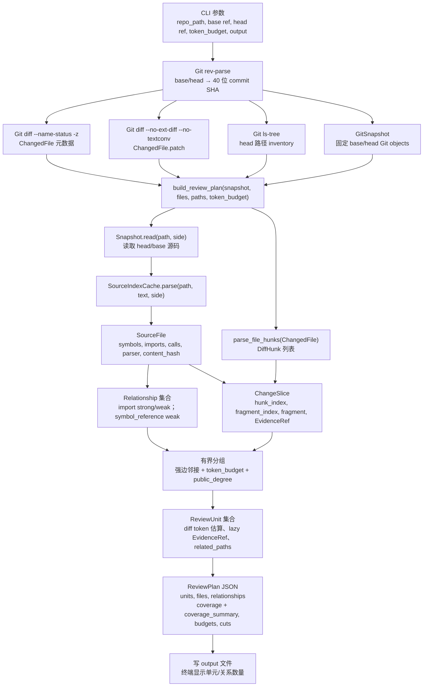
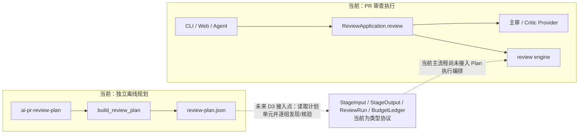

# 离线 Graph Planning 数据流

本文描述 `ai-pr-review-plan` 当前实际执行的数据流，以及它与现有 PR Review 执行链之间的边界。图规划是独立离线入口：读取固定 Git base/head 的差异和源码快照，生成 JSON 计划；它不调用模型，也没有接入 CLI/Web/Agent 的审查执行。

## 当前实现



`MemorySnapshot` 是测试中实现的轻量替身，遵循相同的 `read(path, side="head") -> str | None` 读取约定；生产 CLI 使用 `GitSnapshot`，将 `repo_path` 与固定 SHA 绑定并读取 Git objects，不读取 checkout 中尚未提交的工作区内容。

## 数据与接口

| 接口/数据 | 关键输入 | 返回/字段 | 当前含义 |
|---|---|---|---|
| `GitSnapshot(root: Path, base: str, head: str)` | 本地仓库路径和两个不可变 40 位 SHA | `read(path: str, side: str = "head") -> str \| None` | `side` 仅接受 `head`/`base`；读取对应 Git object，拒绝不安全路径、缺失对象或超限文件。 |
| `Snapshot` protocol | `base`、`head`；`read(path, side)` | 另声明 `search(symbol, side, limit)`、`audit()` | 图规划实际读取源码依赖 `read`；规划函数不调用 protocol 上的 `search`/`audit`。 |
| `ChangedFile` | `filename`、`status`、`patch`、可选 `previous_filename` | 传给 `parse_file_hunks(file)` | CLI 通过 `git diff --no-renames` 生成；因此 CLI 重命名表现为删除/新增。库接口可接收 `previous_filename`。 |
| `DiffHunk` | `ChangedFile.patch` 中的 unified diff hunk | `old_start/count`、`new_start/count`、`added_lines`、`removed_lines`、`raw` | `raw` 保留 hunk 内容，供后续按预算拆片。 |
| `SourceIndexCache.parse(path, text, side)` | 路径、源码文本、快照侧 | `SourceFile` | 有界的单次运行缓存，键为 `(path, side, sha256(text))`；不缓存模型结论。 |
| `SourceFile` / `SourceSymbol` | Python AST 或 TS/TSX Tree-sitter 解析 | 文件哈希、解析器名、定义名与行范围、导入、语法调用及限制 | 对其他语言标记 `unavailable`；TS 不解析类型。`SourceSymbol` 用于按 hunk 行范围定位相关定义并生成 `EvidenceRef`。 |
| `Relationship` | 源文件路径、目标文件路径、关系类型 | `source`, `target`, `kind`, `strength`, 可选 `symbol` | 图节点是**文件路径**，当前是文件级依赖/引用图，不是函数级调用图。唯一解析目标的本地 import 为 strong；多个候选为 weak；按同名调用/定义匹配得到的 `symbol_reference` 始终是 weak。 |
| `ChangeSlice` | 一个 `DiffHunk` 与其片段序号 | `hunk_id`, `hunk_index`, `fragment_index`, `fragment`, `lines`, `symbols`, `evidence`, `estimated_tokens` | 超预算 hunk 分片；索引从 0 开始。`hunk_id` 绑定文件、hunk 序号与原始文本。`lines` 是该片段覆盖的源码行区间（new/old 各自 start/end），`cuts_a_diff_line` 表示分片边界落在某一行中间，此时该行不是完整行。 |
| `EvidenceRef` | 相关定义源码 | `path`, `side`, `start`, `end`, `content_hash` | 只保存延迟读取引用，不把定义文本本身计入当前 diff token 预算。 |
| `ReviewUnit` | 被分到同一组的 slices | `unit_id`, `slices`, `estimated_tokens`, `evidence`, `related_paths` | 单元估算基于拼接后的 diff fragments；相关文件可包括强弱关系边上的邻居。 |
| `ReviewPlan` | 固定 base/head、预算及组装结果 | `units`, `files`, `relationships`, `coverage`, `coverage_summary`, `budgets`, `cuts`, `limitations` | `version="syntax-plan-v2"`；JSON 是规划产物，不是审查报告。`coverage_summary` 声明每个已解析 hunk/文件是否被解释，`budgets` 是本产物自己的预算与遗漏账本。 |

入口签名为 `build_review_plan(snapshot, files, paths, *, token_budget=6000, index_file_limit=5000, index_char_limit=20_000_000, public_degree=8, index_cache=None) -> ReviewPlan`。当前 `token_budget` 只约束分组后拼接的 diff fragment tokens；系统提示、`EvidenceRef` 指向的定义源码及模型输出不在这个预算里。计划会记录 `evidence_refs_are_lazy_and_not_in_diff_token_budget`。

## 预算与遗漏账本（2026-10-15）

此前“预算”是散落的整数：planner 的 diff token budget、生产 `max_patch_tokens`、grounded 证据预算和 context pack 上限互不相通，`128` 与 `881` 这类数字被放在一起比较。现在每个产物都带一份 `BudgetReport`（见 [`src/application/protocol.py`](../src/application/protocol.py)）：

- `BudgetLine(name, limit, used, covers)`：`limit=None` 表示这是被测出的数值而非强制上限；`covers` 写明该数字约束什么、不约束什么。
- `Omission(path, reason, hunk_id, detail)`：被排除、无法取得或只部分进入产物的对象，reason 是稳定字符串。
- `BudgetReport.scope`：标明这是哪个产物的账本。不同阶段的预算即使字段同名也不可互换。

planner 的四行分别是：`diff_fragments_per_unit`（真正被强制的每单元上限）、`diff_fragments_total`（跨单元合计，只是测量值）、`indexed_files`、`indexed_source_chars`。生产 `build_review_context` 的账本 scope 是 `build_review_context`，包含 `context_pack`、`patch_context`、`per_file_patch`，并把逐文件遗漏写进 `omissions`；其中 `patch_clipped`、`full_file_substituted_*` 属于“部分进入上下文”，会经 `partial_inclusion_warning()` 变成报告里的显式警告，而不是只留一个 `truncated=True`。

`ReviewPlan.coverage_summary` 是防回归的不变量：`unaccounted_hunks` / `unaccounted_files` 必须为空，`complete=True` 才表示“每个读到的 hunk 与变更文件都有解释或切片”。它不会让遗漏消失，但会让遗漏无法再悄悄发生。

固定引用规则（同一轮修改）：生产侧读取上下文只接受 40 位 commit SHA。此前 `_fetch_repo_file_text` 在指定 ref 失败时会回退到 `main`，等于把不属于该 PR 的代码放进审查上下文而报告仍声称描述该 PR；现在分支名、缺失 SHA 和读取失败都只返回 `None`，并由 `no_frozen_ref` / `patch_unavailable` 记录原因。

## 生产侧 chunk 覆盖账本（2026-10-15 第二轮）

planner 有 `coverage`/`coverage_summary`，但真正决定模型看到什么的是 `build_review_context`。现在它也有同构的账本：

- `ChunkCoverage`：**每个变更文件一条**，字段 `mode`（`diff` / `substituted`）、`status`（`included` / `partial` / `excluded`）、`hunks_total/complete/partial/omitted`、`reason`。
- `ChunkCoverageSummary.complete` 只声明"**没有文件没被解释**"，不声明"diff 被审完了"。循环里未被任何分支处理的文件保持 `not_processed`，会落进 `unaccounted_files`——这是防空转的回归信号。
- `mode="substituted"`（整文件替换）单独计数并**不计入 hunk 统计**：这类文件的 hunk 级覆盖按定义就是未知的，混进去会让数字好看而不是真实。
- `status` 三态严格区分：`excluded`（策略性忽略）、`partial`（进去了但只进去一部分）、以及 `excluded` + `reason="patch_budget_too_small"`（预算小到连一个 hunk 都没完整进去，此时说 `partial` 就是夸大）。

**分母稳定性（本轮修掉的一个记账缺陷）**：此前预算耗尽的文件直接 `continue`，它的 hunks 从未被计数，于是 `hunks_total` 会随预算缩小而缩小——128 字节预算下分母从 22 掉到 18，任何"覆盖率"都会因此说谎。现在这类文件仍解析并记录 `hunks_total = hunks_omitted = len(hunks)`，**分母恒定**。

## 冻结区间对照基线（planner vs production）

`scripts/context_baseline.py` 在同一冻结区间上同时构建生产上下文与 planner 计划，产出 [context-baseline-89943fe-13e9a3e.json](evaluation/context-baseline-89943fe-13e9a3e.json)（`remote_fetch=false`、`context_pack=false`，无模型调用）。

`89943fe → 13e9a3e`、13 个变更文件、22 个 hunk，`patch_token_budget` 从 1000 到 6000 的阶梯：

| patch budget | 文件 included / partial / excluded | hunk complete / partial / omitted | 分母 |
|---:|---|---|---:|
| 1000 | 3 / 6 / 4 | 5 / 6 / 11 | 22 |
| 2000 | 5 / 6 / 2 | 9 / 6 / 7 | 22 |
| 4000 | 7 / 6 / 0 | 13 / 6 / 3 | 22 |
| **6000（生产默认）** | **9 / 4 / 0** | **18 / 4 / 0** | **22** |

同一产物里的对照字段：

- `hunk_totals_match = true`：两条路径对"这次 diff 有多少个 hunk"的答案一致（都来自 `parse_file_hunks`），所以两侧数字可以并列看；
- `planned_hunks = 22`，`context_hunks_complete = 18`，`hunks_planned_not_complete_in_context = 4`；
- `files_planned_but_not_in_context = []`，`files_in_context_but_not_planned = []`。

**这是一张诚实但有信息量的成绩单**：默认预算下没有任何文件被完全丢弃，但**22 个 hunk 里有 4 个只是部分进入 prompt**。仅按文件粒度记账（此前只有 `skipped_context_files`）会把 13 个文件全部记成"已包含"，这 4 个 hunk 的损失是不可见的。

## 源码策略分歧（已用窄口径修复）

planner 用 `repository_context.safe_source_path` 过滤路径；生产 `build_review_context` 此前**只**做 `_skip_patch_reason`（lockfile / demo / 评测 JSON）与二进制检查。结果是：`safe_source_path` 会拒绝的 `.env*`、`.pem`、`node_modules/` 等路径，在生产侧**会被拼进模型 prompt**，并可能随 GitHub 行内评论公开。

修复采用**窄口径**而不是直接套用 `safe_source_path`，因为后者要求后缀在 `SOURCE_SUFFIXES` 内，会连带排除 `go.mod`、`requirements.txt`、`.css`、`.proto` 等正常需要审查的文件：

- `_secret_adjacent_reason()`：拒绝 `.env*` / `.npmrc` / `.pypirc` / `.netrc` / `id_rsa` 等名称、`.pem/.key/.p12/.pfx/.keystore/.jks/.ppk` 后缀、以及 `.git`/`node_modules`/`vendor`/`dist`/`build` 目录下的路径；
- 拒绝原因进入 `coverage.reason`（`secret_adjacent_path_not_analyzed` / `vendored_path_not_analyzed`），**不是静默跳过**；
- 明确的边界测试：`go.mod`、`requirements.txt`、`app/styles.css` 仍然照常进入审查。

这是一个**行为收窄**：如果用户希望生产侧完全对齐 planner 的 `safe_source_path`（会少审 `go.mod` 一类文件），需要显式决定，当前实现只在"密钥材料 + 已签入构建产物"这一子集上收窄。

## 一次运行的预算总账（2026-10-15 第三轮）

前两轮给出的是**各产物自己的账本**（`scope=build_review_plan`、`build_review_context`）。它们各自正确，但没有任何地方能回答"这次审查一共往 prompt 里放了多少 token"。第三轮补上：

- `RunBudgetReport`（定义在 [src/models.py](../src/models.py)，与 `BudgetReport` 同层，避免与报告契约循环依赖）：`reports` 是各 scope 的账本，`capped_scopes` 指明**哪些 scope 计入总量**，`cap` 是可选的全局上限。
- `BudgetLine.aggregate`：默认 `True`；`per_file_patch` 这类"对子集的 cap"标为 `False`，**不会被加进总量**（否则单个文件的 cap 会被重复计入 patch 总量）。
- `total_used` 统计 capped scope 里所有 aggregate 行——**与那一行自己有没有 limit 无关**：没有配置 limit 的输入仍然是输入。`cap=None` 时只测量、不判定超限，不会凭空造出一个上限。
- `reviewer/budget.py` 定义 `REVIEW_INPUT_SCOPES = ("build_review_context", "repository_evidence")`，并提供 `budget_warnings()`：超限与超 cap 分别产出**读者可见**的 warning，进入 `ReviewReport.analysis_warnings`。
- 证据侧也有账本：`EvidenceBundle.budget_report`（scope `repository_evidence`）把 `budget`/`tokens` 与 `omitted`/`evicted` 的原因变成同构条目，`source_unavailable` / `line_out_of_range` / `evidence_budget_exhausted` / `evidence_evicted_for_requested_context` 都能被一次运行统一汇总。
- `ReviewReport.budget_report` 是新增的**附加字段**（JSON 报告经 `model_dump` 自动携带，不改现有字段），Web/VS Code 可以据此显示一次运行的输入总量。

配置项 `MAX_REVIEW_INPUT_TOKENS`（`Settings.max_review_input_tokens`）默认 **None**：默认只测量并记录，**不改变任何现有行为**。参考 pr-agent 用 `max_model_tokens=32000` 统一钳制所有模型；本仓库现在有能力做同样的事，但**默认不打开**，因为收紧预算会减少模型可见的 diff，属于质量取舍而非纯可靠性问题。

**边界（不要外推）**：`total_used` 只覆盖 patch 上下文与证据摘录，**不包含** system prompt、系统指令、模型输出与供应商侧的 KV 缓存；`cap` 也不是费用上限（计费按供应商实际输入/缓存/输出计）。

分组只沿 strong relationship 的无向邻接扩展。这里的节点是文件路径；strong 表示 import 在给定路径 inventory 中解析到唯一文件，不等于已证明运行时调用。弱引用不驱动合并，但会进入 `related_paths`。遍历受 `token_budget` 和 `public_degree` 限制；高连接节点可作为相关证据，不会强制把所有消费者合成一个超大单元。这是语法级启发式边界，不是函数级语义调用图或最优分组证明。

## 大 PR 的上下文现实（2026-10-15 实测）

默认 `max_patch_tokens=6000` 是从小 PR 时代继承下来的保守值，**仓库里没有任何它被测量过的记录**。用一个真实大 PR 量一下（PR #45：`main...HEAD`，与 main 的 merge-base 为 `d99524db81`）：

| 项 | 实测 |
|---|---:|
| 变更文件 | **187** |
| hunk | 337（其中 193 个进入扫描范围，94 个文件被策略排除） |
| 原始 diff 文本 | 1,805,662 字符 ≈ **588,648 tokens** |

同一份 diff 在不同 patch 预算下的生产上下文：

| patch 预算 | 上下文 tokens | 完整看到的 hunk | 部分 | 完全没进 |
|---:|---:|---:|---:|---:|
| **6,000（当前默认）** | 19,532 | **22 / 193（11%）** | 5 | **166** |
| 32,000 | 45,391 | 64 / 193 | 4 | 125 |
| 128,000 | 140,914 | 159 / 193 | 2 | 32 |
| 600,000 | 202,007 | 193 / 193 | 0 | 0 |

**结论（重要，会改变方向）**：大 PR 的 diff 本身就 **≈59 万 tokens**，而主流模型上下文窗口在 12.8 万量级。所以"把 6000 调大"**不是解法**——调到 60 万也塞不进一次调用，只会把问题推迟到 API 报错。真正的解法是**按单元分片、逐单元审查并迭代**，也就是离线 planner 已经在算的 `ReviewUnit`（当前**没有接入生产链路**）。默认预算下"只审了 11% 的 hunk"，根因不是预算数值，而是**生产路径在用截断代替分片**。

## 供应商 prefix cache：怎么算、实测多少

`prompt_cache_hit_tokens` / `prompt_cache_miss_tokens` 由 API 在 `usage` 里返回，**本仓库的 provider 已经原样保存了这个字典**（`OpenAICompatibleProvider.usage_records`），所以加指标**不需要改 provider**：

```
cache 命中率 = prompt_cache_hit_tokens / (prompt_cache_hit_tokens + prompt_cache_miss_tokens)
```

实测（2026-10-15，`deepseek-v4-flash`，共享前缀 = 冻结区间的生产上下文 ≈6.9k tokens，连续 3 次调用）：

```
call 1: prompt=6,475  hit=6,272  miss=203  rate=96.9%
call 2: prompt=6,475  hit=6,272  miss=203  rate=96.9%
call 3: prompt=6,475  hit=6,272  miss=203  rate=96.9%
```

三点观察：

1. 连**第一次**调用就已经命中（96.9%）——前缀缓存是账号/前缀级的，之前那次真实运行已经把这段前缀暖起来；
2. 未命中的 203 tokens 就是**动态尾部**（本次只有一句指令）；
3. 所以"稳定前缀在前、动态内容在后"在**当前结构下已天然满足**；要拿收益，需要的是**把命中率记录下来并核价**，而不是重排 prompt。

注意计费口径：命中的输入**仍按 logical tokens 计数**，只是单价有折扣；不得把"命中"说成"没花钱"。

### 分片接入的第一步（2026-10-15）：单元级账目进了报告

默认路径仍是"一次调用 + 截断"，但现在已经能回答**哪些语义单元根本没被审**：当 prompt 被截断时，`review_grounded` 就地构建 `ReviewPlan`（离线、无模型调用；187 文件的 PR 实测约 **11 秒**），把 `units_planned` / `units_with_evidence_in_prompt` / `units_fully_in_prompt` / `units_not_reviewed` 写进报告 `metrics`，并在 `analysis_warnings` 写一条**带样例路径**的警告。

实测：

| 范围 | 结果 |
|---|---|
| 本仓库 PR #45（187 文件） | 规划出 **88 个单元** |
| 小冻结区间（13 文件） | 14 个单元 → 10 个进入 prompt、8 个完整、**4 个完全没审**（正好是被排除的 `.md` 文档） |

**仍未做**：真正的"逐单元迭代"执行方式。当前单元账目只让缺口**可见**，没有改变"一次调用"的事实。按单元逐个调用（88 单元 × 约 1.5–2 万 tokens）在同一个 PR 上估算约 **1.6–2.2M tokens ≈ 2 元**，这是下一步要评估并做对照的事。

## 与主审查链的边界



`ReviewApplication` 目前负责模型 Provider 生命周期、Critic Provider 和冻结仓库 reader 的所有权；`protocol.py` 定义 `ReviewRun`、`StageInput`、`StageOutput`、`BudgetLedger` 等类型。仓库中只有 `src/cli/plan.py` 调用 `build_review_plan`，主审查入口没有读取 `ReviewPlan` 或逐 `ReviewUnit` 调度。图中的虚线是 D3 的未来连接点，不表示已有队列、恢复、LLM 分组调用或发布流程。

## 离线样例：输入到分组结果

使用内存快照运行 `build_review_plan`，输入包含一个 Python import 链、一个无关 Python 模块和一对 TS 接口文件。下面分别是实际运行使用的合法 base/head 源码；`ChangedFile.patch` 由每对源码的 unified diff 生成，因此 hunk 与快照内容一致。预算为 6,000 tokens。

```json
{"base": {
  "app.py": "from service import run\ndef endpoint():\n    return 0\n",
  "service.py": "def run():\n    return 0\n",
  "standalone.py": "def unrelated():\n    return 6\n",
  "api.ts": "import { User } from './types.js';\nexport function show(u: User) { return u.name; }\n",
  "types.ts": "export interface User { id: number; name: string }\n"
}, "head": {
  "app.py": "from service import run\ndef endpoint():\n    return run()\n",
  "service.py": "def run():\n    return 1\n",
  "standalone.py": "def unrelated():\n    return 7\n",
  "api.ts": "import { User } from './types.js';\nexport function show(u: User) { return u.id; }\n",
  "types.ts": "export interface User { id: string }\n"
}}
```

每个单文件源码都作为独立文件文本传给 `MemorySnapshot`。运行脚本按 `sorted(head)` 遍历路径，为每一对 base/head 文本执行 `difflib.unified_diff(base[path].splitlines(), head[path].splitlines(), fromfile="a/" + path, tofile="b/" + path)`，把结果以换行连接后传入 `ChangedFile(filename=path, status=FileStatus.MODIFIED, patch=patch)`；再调用 `build_review_plan(MemorySnapshot(base, head), files, list(head), token_budget=6000)`。因此示例中的 hunk 是与快照一致的本地 fixture diff，不是任意拼造、也不是实际仓库提交的 patch。

实际离线运行得到的关键结果：

```text
relationships:
  api.ts -> types.ts       import            strong
  app.py -> service.py     import            strong
  app.py -> service.py     symbol_reference  weak (symbol=run)

units:
  [api.ts, types.ts]       75 estimated diff tokens
  [app.py, service.py]     55 estimated diff tokens
  [standalone.py]          25 estimated diff tokens

slices: 5 hunks → 5 slices; each slice has hunk_index=0, fragment_index=0
coverage: all 5 input paths are planned
coverage_summary: complete=true, unaccounted_hunks=[], unaccounted_files=[]
budgets: scope=build_review_plan; diff_fragments_per_unit limit=6000, omission_reasons={}
limitations: evidence_refs_are_lazy_and_not_in_diff_token_budget
```

这说明给定这组语法输入时，唯一解析的 import 边让文件进入同一个单元；独立文件保持单独。它只验证这一组输入到输出的可解释映射，不证明语义分组普遍正确、最佳或提升审查质量。

## 验证记录与边界

- 2026-10-15（第三轮）：`pytest` **236 passed**；CI 最低 Ruff gate 通过；改动文件全量 Ruff 通过，`context_builder.py` / `grounded_review.py` / `repository_context.py` / `engine.py` 的长行内容集相对 HEAD 无新增。
- 2026-10-15（第二轮）：`pytest` 228 passed；离线对照基线见上节。
- 2026-10-15（第一轮）：`pytest` 217 passed；`ruff check --select E9,F63,F7,F82 src tests` 通过；新增模块与测试全量 Ruff 通过；`context_builder.py` 的既有 lint 数量未增加。
- 冻结离线基线：`scripts/plan_baseline.py --base 89943fe --head 13e9a3e --token-budget 1000` 产出 [plan-baseline-89943fe-13e9a3e.json](evaluation/plan-baseline-89943fe-13e9a3e.json)。结果 14 units、23 slices、22 planned hunks，`coverage_summary.complete=true`，`omission_reasons={}`，`budget_over_limit=[]`；`diff_fragments_per_unit.used=986/1000`，`relationships` 238 strong + 970 weak，`cuts` 记录 17 条被跨组切开的强边、39 个变更符号的外部调用方。23/23 slices 都有行区间，0 个切在行中间。这些数字与历史记录一致，说明新增账本没有改变分组结果；它证明的是会计与可复现性，不是分组质量或审查召回。
- 基线的输入只有 git object：`load_frozen_plan_inputs` 先 `rev-parse` 成 40 位 SHA 再读，未提交的工作区内容不会进入产物（测试用 sentinel 验证）。
- 历史记录：2026-10-14 D1/D2 交付称 181 项 pytest 通过；固定范围 `89943fe → 13e9a3e`、`token_budget=1000` 时 22 hunks、14 units、最大单元 986；索引 238 import 关系、970 弱符号关系。这些数字说明覆盖、确定性与 diff 预算约束；关系条数不是已证明调用路径条数。真实语义分组质量、Precision/Recall、实际模型 token 消耗与费用变化均未验证。本功能未使用付费模型。
