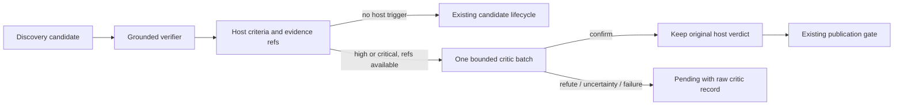

# Grounded Critic iteration

This iteration adds an opt-in adversarial pass after the existing grounded host
criteria. The default remains off. The critic sees only the candidate id,
candidate summary, and host-verified evidence excerpts that the first verifier
actually cited and the grounded prompt already displayed.

The critic cannot call tools, invent sources, confirm a candidate for the host,
change confidence, or dismiss a finding. A `refute` becomes a shadow refutation
and moves the candidate to pending for human or later host review. A configured
batch cap also moves eligible overflow candidates to pending. Provider failure,
malformed output, budget refusal, missing/duplicate ids, or unknown evidence
references keep the selected candidates pending with the response and reason
recorded in the review trace. Repository-index mode remains governed by its
existing all-model-candidates-pending rule; a critic confirmation cannot clear
unknown causal attribution.

## Offline comparison

Use a fixed synthetic candidate set and a deterministic fake provider. Compare
the ordinary grounded gate with the same gate plus the critic decisions below.
This checks lifecycle behavior only; it does not estimate real-world precision
or recall.

| Synthetic input | Critic result | Expected host result |
|---|---|---|
| No high/critical host-confirmed candidate | no request | Existing host result, zero critic requests |
| One high candidate with verified refs | `confirm` at confidence 1.0 | Original host confidence and publication gate remain unchanged |
| One high candidate with verified refs | `refute` with those refs | Candidate remains visible as pending; no automatic dismissal |
| Selected candidate | timeout, malformed JSON, or exhausted shared budget | Candidate remains pending with raw response/error status |
| More candidates than the configured cap | any | Overflow is pending with `critic_skipped_budget`; only one batch is sent |
| Host rule fact plus a model candidate | arbitrary critic text | Host rule fact remains controlled by its deterministic rule path |

`CRITERIA_VERSION`, effective strategy identity, candidate audit, and embedded
review trace record the behavior change. When no separate critic provider is
configured, direct review calls use the main provider for the critic request.
The critic uses the existing shared request budget, with a separate bounded
output-token limit. In repository-index mode it may assess cited evidence, but
cannot clear unknown causal attribution; those candidates remain pending.
Checkpoint identity includes the critic output limit and a hash of the effective
critic provider configuration. No paid quality run or default activation is part
of this iteration.
