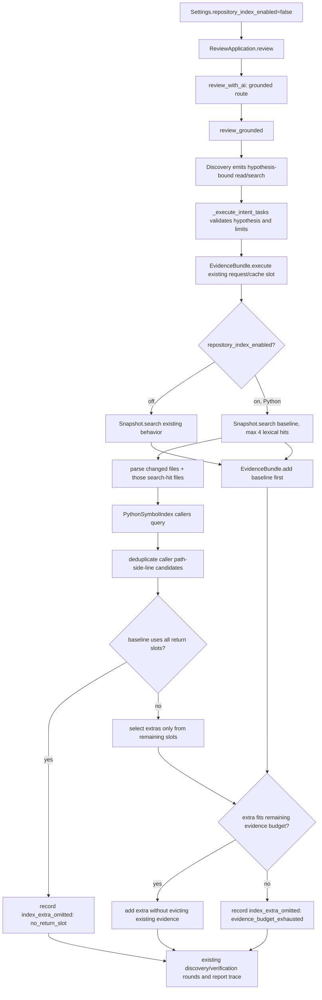
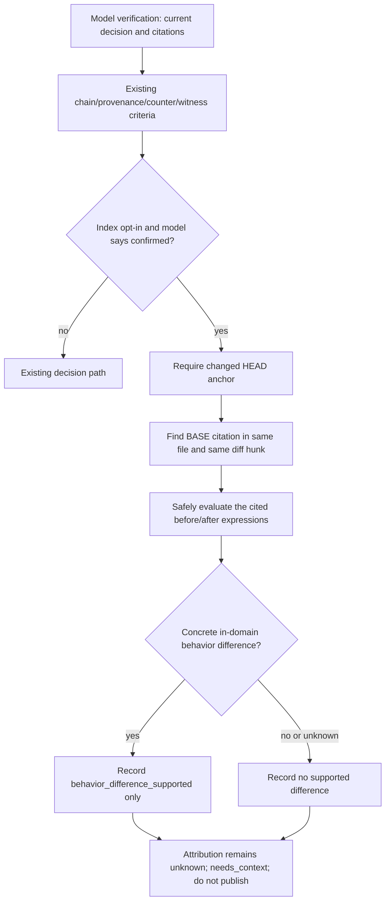
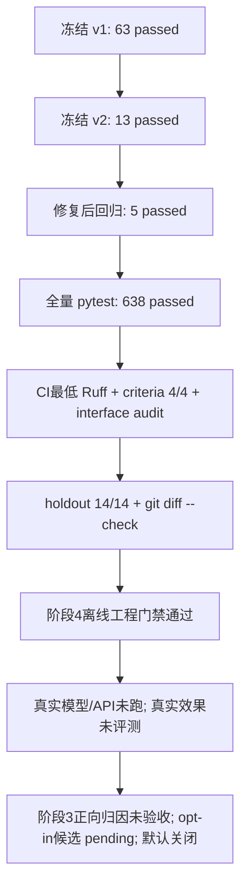

# 根因调查阶段 2/3：接线与归因边界 v1

状态：接线已实现，待主线整合验收；阶段 3 仅实现行为差异记录和 fail-closed 发布门禁，正向新增/加重归因尚未验收。该版本记录不替代 `repo-root-cause-agent-design.md` 的总体设计。

## 阶段 2：受限索引接线

The index is activated only inside an already-validated model `search` request. It adds no provider tool, URL, request slot, task loop, or model round. Existing hypothesis binding, query de-duplication, request caps, and citation validation remain in force. Lexical hits keep their original order and are added first. Caller candidates are deduplicated by path, side, and source line, then use only free return slots. Indexed extras do not evict existing bundle excerpts; an extra that cannot fit the remaining evidence budget is omitted with a request-level reason. A request whose baseline evidence cannot fit skips all indexed extras. This proves only local single-request non-displacement under the same request and budget, not preservation across later unrelated future requests.

The index scope is at most 12 unique side/path pairs across the review, drawn from changed paths and the existing lexical-search hits. Each parsed file is capped at 100 KB and total parsed source at 400 KB per review, shared by all search requests. The underlying snapshot search retains its own limits. Scope is always reported `partial`: a complete result only describes paths the request actually indexed. Base and head are queried independently; missing base caller scope is an omission, never proof that the caller did not exist.

The local trace records index schema, side and SHAs, scope, omissions, parsed file/byte counts, elapsed scan time, and bounded relationship ranges. Source text and prompts remain out of the trace. Parsed scan bytes are not model tokens; rendered code still consumes only the existing repository-evidence budget. Unit checkpoint identity includes the feature flag and index schema to prevent off/on result reuse.

## 阶段 3：候选变更归因

The model's `introduced_by`, `call_path`, cited text, and static edges remain claims or navigation clues. The host may record that expressions in one edited block differ on a bounded input, but this does not tie that difference to the candidate's trigger or failure path and therefore never produces an `introduced` label. Opt-in model-confirmed findings stay `needs_context` with `attribution=unknown` until a candidate-specific causal check is designed and validated. The implementation never labels `preexisting` from equal source text, never infers introduction from a static edge, and does not equate arbitrary different excerpts with causation.

This deliberately leaves non-expression behavior, added files without a base counterpart, unsupported expressions, missing base scope, ambiguous bindings, and the linkage between an expression difference and a model candidate unknown. Behavior-difference status is diagnostic only and does not alter existing witness rules. Deterministic test-quality rule facts retain their route only when their candidate identity matches output from the host rule collector; a model title or source field cannot claim that provenance. The default-off route keeps its existing confirmation behavior.

## Files and current status

- `src/utils/config.py`, `src/application/review.py`, `src/reviewer/engine.py`: single opt-in setting, shared application pass-through, policy/prompt/checkpoint identity.
- `src/analyzer/repository_context.py`, `src/reviewer/grounded_review.py`: existing search hook, bounded index lookup, evidence accounting and trace.
- `src/reviewer/criteria.py`: opt-in paired-change guard and criteria version.
- `tests/test_enabled_features.py`, `tests/test_grounded_review.py`: opt-in/fail-closed, legacy-default, shared index budget/partial-scope and causal counterexamples.

`src/analyzer/review_plan.py`, `src/analyzer/symbol_index.py`, and `tests/test_review_plan.py` are owned by the stage 1 worker and are not modified by this stage. Stage 2/3 do not add a whole-repository inventory method to `Snapshot`.

## Acceptance still required

The dependency wiring is implemented, but this document does not claim quality improvement or complete call-graph coverage. Acceptance requires the narrow offline tests above, an opt-in/off trace comparison, and a manual audit that source bytes and evidence tokens remain bounded. Same-name collisions must stay ambiguous; an unchanged callee with a changed caller must not be mislabeled `preexisting`; a same-edit-block expression difference must not be mislabeled `introduced`; a forged `[TQ123]` title must not bypass attribution; and an actual host rule candidate must retain its deterministic route. Positive introduced/worsened attribution remains unaccepted. No real model, API, or holdout evaluation is implied by unit tests.

## 阶段 4：主线离线验收记录（2026-10-21）

基线 HEAD：`df397d549df352b991572f7a39c4afee6689335e`。代码差分按当前工作区统计：已跟踪源码 `+489/-138` 行，另有未跟踪 `src/analyzer/symbol_index.py` 672 行；已跟踪测试 `+438/-23` 行。工作区另有既存评估报告和旧文档清理，不计入本轮代码行数。

离线验证结果：冻结 v1 定向组 63 passed、v2 定向组 13 passed；修复后回归的 5 项 passed，全量 pytest 638 passed、0 failed，用时 30.94 秒，伴随 1 条 Starlette/httpx 弃用警告。CI 最低 Ruff 规则、`criteria_gate.py`（4/4）、`interface_audit.py`（无失效 flag 或未知关键字；另有 5 条普通未使用形参提示）、`holdout_eval.py`（14/14）及 `git diff --check` 均通过。测试进程使用假 API key、本机不可用 endpoint，并禁用 `.env` 加载；没有真实模型/API 请求或网络评测。

真实效果尚未评测。阶段 3 的正向新增/加重归因仍未验收；所有 opt-in 模型候选保持 `pending`，`repository_index_enabled` 默认 `False`。

## 阶段 5：baseline-first 索引证据约束（2026-10-21）

同一冻结 P0 案例、查询、顺序和 6000 字节上界的离线 host 回放见 `docs/evaluation/index-evidence-p0-baseline-first-2026-10-21.md` 与同名 JSON。直接搜索命中在前；索引候选只占用剩余返回名额与真实剩余证据预算。定向回归覆盖满 top4、空 baseline、有重复弱边、side/range、索引异常回退和预算不足。该结果只证明局部请求不会由索引排序或预算回收挤掉 baseline，不证明候选语义质量、召回改善或模型曝光。原始 P0 报告及 JSON 保留不覆盖。
