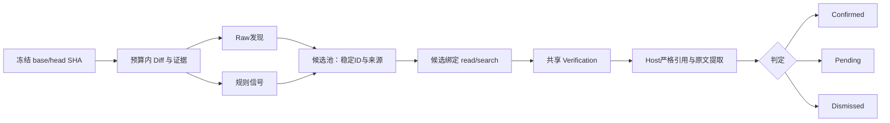

# Review V2：候选发现与核验改造计划

更新：2026-11-05。目标是形成一条可追踪的最小闭环：Raw 发现与规则信号进入候选池，候选保留来源，候选绑定 read/search 取证，共享 Verification 核验，Host 按严格引用提取原文，最终进入 Confirmed、Pending 或 Dismissed。五批均未开始；每批完整交付并提交后再进入下一批，不拆成只改接口的碎片提交。默认策略在测量完成前保留。

## 当前依据

- 真实种子案例：`reports/evaluation/aa_factory_grounded_small/{run,requests-responses,candidate-verdict}.json`，AA-Factory PR 17。
- 该案例有 2 次 HTTP 请求，5683 prompt tokens、1988 completion tokens、10.885 秒，估算费用约 0.03 元。候选 1 个与 gold 匹配，但模型把第 18 行 `mocker.patch` 与第 19 行参数合并成 19 行 quote；Host 严格引用校验拒绝该引用。结果为 Pending 1、Confirmed 0。不能将其表述为 Host 错误删除。
- 离线回放该响应时，旧 quote 仍应被拒绝。模型若显式引用准确的两行范围，Host 可依据已展示的 `evidence_ref` 和精确行范围提取原文；这只满足来源约束，不保证最终 Confirmed。

## 2026-11-05 修订边界（优先于下文冲突表述）

- **性质**：本次同时包含行为修复（候选来源丢失、解析失败影响整批、Raw 完整 diff 绕过预算、TQ 强制覆盖核验）与测量修复；评测用于确认修复收益，不是唯一目的。
- **现状口径**：Raw 实际执行 3 次 Discovery 调用；完整流程成本倍数需实测。已有 Critic 回放、合成判据集与部分故障测试；缺的是共享 Grounded Verification 回放、新鲜独立留出和本轮改造对应的故障覆盖。已有能力按“代码接通 / 测试覆盖 / 真实运行 / 质量收益”四类证据分别判断。
- **顺序**：数据盘点、裁定表、协议准备与代码并行；批次 1→2→3→4 顺序交付。批次 2 先做纯重构并用保存响应验证前后一致，TQ 覆盖、解析与过滤的行为调整随后单独提交并记录预期差异。
- **工作量**：1300–2000 行仅为初估，未核对核验循环依赖、checkpoint 序列化与多单元合并；交付时分别统计新增、删除、搬移与测试变更，代码量不作验收目标。
- **解析修复**：仅处理已明确支持的格式包装；缺失括号可能来自截断，不补齐。保留原始响应与逐条解析错误。
- **引用合法性**：依据冻结快照、最终请求正文中的实际展示范围、连续行号与长度上限判定，不以 hunk 边界判定；被裁掉未发送的内容判为未展示。
- **Raw origin 选择**：先盘点历史记录是否含完整候选正文；不足时使用预先指定的单次配置，不据残缺记录选优。
- **故障测试**：按改动范围执行相关用例并保留回归，最终完整验收一次。“重跑不重复调用/评论”仅限已有可靠产物或已确认发布记录；远端已处理但本地未保存的窗口如实记录。
- **实验**：增加同输入预算的 One-shot 基线；先在开发集做 A/B/C/D 消融，冻结实现与默认配置后再跑新鲜留出；B3 三次集成后置。回放分三类：保存响应重放（免费，验证解析/判据/状态）、固定候选重调 Verification（付费）、完整端到端（付费）。修改 Prompt 后旧响应重放不能验证新 Prompt。裁定人若知道组别须如实记录，不称盲评。费用上限与最终裁定人不阻塞离线开发。

## 目标流程与依赖

| 批次 | 交付 | 依赖 | 验收 |
|---|---|---|---|
| 1 | 候选记录、trace、账本能表达 Raw/规则来源与合并成员 | 现有候选、trace、账本 | 逐条解析错误不丢整批；run 内 ID 稳定；D 统计全部原始发现，包括已发布、过滤及待核验候选 |
| 2 | 抽取 grounded_review 的真实共享 Verification | 批次 1 的候选身份；现有在线响应与保存响应回放 | 在线和离线回放调用同一核验逻辑；精确行范围可由已展示 evidence_ref 取原文；旧 quote 仍拒绝，不猜行、不模糊放行 |
| 3 | Raw 与规则候选在同预算上下文合流 | 批次 1 候选池；批次 2 的核验入口 | Raw 从实际 3 次调用收敛为单次配置与规则候选合流；fullpatch 不旁路；3 次集成仅作为显式实验 |
| 4 | 取证严格绑定 candidate_id，复用已有停止与缓存机制 | 批次 1–3 | 复用现有 hypothesis/bundle/cache/no-new-evidence 停止；取消 TQ 结构事实对 verifier Confirmed 的强制覆盖；固定候选池消融 hedging 与 malformed 词过滤 |
| 5 | 低成本同 PR、同 SHA 模型预算实验 | 前四批完成；离线回放先行 | 对照 A/B/C/D 与语义、成本、延迟、位置 proxy；每方案独立预算；无效路径在测量后删除 |

## 分批实施契约

### 批次 1：候选来源与完整账本（未开始）

**范围**：`src/models.py`、`src/reviewer/grounded_review.py`、`src/reviewer/candidate_dedupe.py`、`src/reviewer/decision_ledger.py`、`src/reviewer/unit_review.py`，以及 `src/evaluation/funnel.py`、`src/evaluation/scoring.py` 和对应测试。候选定义、合并、恢复与统计同步调整。

**接口与依赖**：扩展现有候选记录、trace 与账本，不新增第二套账本。定义 run 内稳定 candidate ID；保存每个候选的 Raw/规则来源、合并成员和后续去向。单条候选解析失败须保留同批其他记录并明确该条错误。保存全部原始发现；D 表示其中语义匹配的独立 Gold 缺陷数，召回率分母仍为 Gold 总数 N。分别报告模型、规则及合并候选的发现数。

**验收**：重复处理同一 run 中同一候选产生稳定 ID；合并记录可还原所有来源成员；混合有效/无效条目保留有效记录；按原始发现核对 D，覆盖 Confirmed、Pending、Dismissed 和过滤候选。

### 批次 2：共享 Verification 与严格引用（未开始）

**范围**：`src/reviewer/grounded_review.py` 的核验循环、`src/reviewer/criteria.py` 的引用校验，以及 `src/evaluation/` 中的回放入口和对应测试。在线路径与回放直接复用抽取的核验实现，避免两套逻辑。

**接口与依赖**：在线响应和已保存响应离线回放进入同一 Verification。新增引用形式接受模型明确给出的已展示 `evidence_ref` 与精确行范围，并从冻结证据中提取原文。现有 quote 路径保持严格校验；不按上下文猜测行号、不接受模糊匹配。此批依赖批次 1 的 candidate ID。

**验收**：AA-Factory 原始响应离线回放仍拒绝跨第 18/19 行拼接的 quote；提供合法、明确的两行范围时，Host 可验证 provenance 并提取对应原文；结果不预设为 Confirmed。

### 批次 3：Raw 与规则候选合流（未开始）

**范围**：`src/reviewer/grounded_review.py` 的 Raw 调用及输出适配、`src/reviewer/candidate_dedupe.py`、`src/utils/config.py` 与配置传递入口。Raw 输入经过相同的上下文预算，不再直接拼入完整 patch。

**接口与依赖**：Raw 配置与规则候选共用同一预算上下文和 candidate ID 空间。当前 Raw 实际执行 3 次；目标为单次 Raw 配置与规则候选合流。3 次集成仅作为显式实验配置，不能成为默认调用路径。依赖批次 1 的来源记录及批次 2 的共享核验。

**验收**：运行 trace 显示单次 Raw 模式调用次数为 1；规则候选与模型候选在同一池内可追踪；fullpatch 与其他输入无旁路；显式实验模式才执行 3 次并单独计预算。

### 批次 4：候选绑定取证与判据收敛（未开始）

**范围**：`src/reviewer/grounded_review.py` 中任务绑定、TQ 判定覆盖和词过滤分支，`src/reviewer/criteria.py` 及对应测试。复用现有 EvidenceBundle 与 Snapshot 缓存。

**接口与依赖**：read/search 任务与 evidence bundle 绑定 candidate_id；复用现有 hypothesis、bundle、cache 和 no-new-evidence 停止条件，避免重建机制。移除 TQ 结构事实对 verifier Confirmed 状态的强制覆盖，最终状态依据共享 Verification 与 Host 引用判据。hedging 和 malformed 词过滤作为固定候选池消融因素记录，不在观察结果后改过滤规则。

**验收**：取证保留候选归属；多个候选可共享同一证据引用，相同证据复用缓存；无新增证据时按现有终止规则结束；TQ 结构事实不能绕过 verifier 直接确认；消融输入、过滤结果和判定可逐条复算。

### 批次 5：受控模型预算实验（未开始；建议预算上限 0.50 元，未执行）

| 方案 | 配置 |
|---|---|
| A | 现有严格策略 |
| B | 单次 Raw |
| C | 复用 B 的候选池，仅核验候选 |
| D | 在 C 上加入规则候选核验 |

**协议与验收**：先离线回放，再对同一 PR、同一 SHA、同模型版本和独立方案预算做小规模比较。每方案单独设定预算，不跨方案挪用。保留默认策略直至结果测量完成；禁止用 holdout 调参。记录语义 Precision/Recall、全部原始发现中的 D、位置 proxy（单列）、实际成本、请求数和延迟；人工语义裁定与位置命中分开。初始证据可见性保持一致，工具补查后的证据另行统计。C/D 复用 B 的发现产物以隔离核验影响；另列端到端完整成本。B 只评价发现能力，C/D 评价最终报告质量。零发布时 Precision 记为无定义。费用、HTTP、累计请求字节、输出 Token 和时长分别设硬上限；不完整运行单列。实验后删除没有效果且不再需要的路径。0.50 元仅为建议上限，本计划未发起付费调用，也不要求本轮授权。

## 共用范围与实施约束

- 仅复用现有候选、trace、账本、取证绑定、缓存和预算机制；不新增数据库、消息队列、框架或重复账本。
- 每批完成全部实现与对应离线验收后再形成完整提交；每批交付同步更新本图和验收记录。五批当前状态均为“未开始”。
- 除批次 5 明确描述的对照实验外，默认策略保持不变。任何模型实验均先离线、再按冻结输入测量；位置 proxy 不替代语义判定。
- 后续条件：核心五批评测完成后，再验证一次失败 trace → 配置候选 → 固定回放 → 接受/拒绝 → 版本回滚的自改进实验，复用现有 policy/gate，不扩展新框架。核心五批不包含索引重做、大 PR 路线或 critic 重做。

历史计划：2026-11-05 前版本（原文完整保留）

# Review V2：当前执行与验收计划

更新：2026-10-18。A/B/C 核心与 unit JSON 结果恢复，以及阶段2意图取证和阶段3 trace→诊断 CLI 已纳入版本控制；最新提交以 `git log` 为准。目标顺序是：**①让现有工具可信；②做跨文件意图 Agent；③用失败案例改进知识与策略**。本文件维护当前执行顺序、验收与实验协议；规范约束见 [HARNESS](HARNESS.md)，带日期的运行状态与测量边界见 [STATE](STATE.md)。[PRD](PRD-review-capability-v2.md)定义目标/非目标，[HANDOFF](../HANDOFF.md)只做当前快照入口。旧 D1–D5、D2 图规划和 RSI 方案只作历史材料，不构成自动执行路线。

本轮前 A/B 已完成并进入代码基线：Playbook 真实 PR repo、语言/path/symbol 作用域与 scoped contract 的 fail-closed 边界；最终上下文排序保留 over-budget triage 优先级。C 已于 `b84fd93` 接通冻结 base/head snapshot Ruff scan、新增行候选归因、明确 unavailable/partial 与同一 snapshot 复用。Unit checkpoint 只从身份匹配、hash 与 schema 校验通过的 JSON 结果产物恢复；metadata-only 不会伪装成功。阶段2和3的实现范围与验收记录见下方“2026-10-18 实施范围与验收”和 [`STATE.md`](STATE.md)。没有真实 PR/模型质量或 token/cost 收益验证。**阶段1仍未全部完成**：snapshot 底层单次读取硬 I/O 上限、启用但未接线路径门禁、完整候选账本与发布幂等仍待做；unit 跨进程并发/强杀恢复不承诺 exactly-once，#46 不可标记关闭。

### 2026-10-17：确定性 Ruff 接线的完成边界

- `src/agent/runner.py`、CLI 与 Web 单 PR detail 在同一分析生命周期创建/复用 snapshot；overview 明确 `not_run`，不为 PR 列表拉取源码或运行 Ruff。Agent 的规则扫描和后续 grounded review 共享 snapshot。
- Ruff 只读取冻结 base/head 的 Python 内容，不回退到当前工作目录；固定隔离参数，不执行 PR 代码。进程 stdout/stderr 共用硬输出上限，超限或 deadline 到期会终止并清理子进程。新增行匹配只产生低置信度 `lint-candidate-*`，不等于语义 Bug 或 confirmed finding。
- 内容读取目前限制读取尝试/返回文本量和后续处理量；`Snapshot.read()` 可能先完整返回一次响应再做大小检查，因此这些值不是硬网络响应上限。严格单次响应截断与可取消读取单独跟进。POSIX 管道实现已验证；Windows 走明确 unavailable 分支，但未实机验证。
- 仓库 `.venv/bin/python -m pytest -q`: 396 passed。仓库 `.venv/bin/ruff check --select E9,F63,F7,F82 src tests`、criteria/holdout/interface 三个离线门禁和 `git diff --check` 通过。无模型请求、真实 PR 质量或成本结论。

### 2026-10-18：unit checkpoint 恢复结果的边界

- 每个 unit 的完整审查结果以受限 schema 的 JSON 产物原子落盘；metadata 仅引用产物名/hash 和执行身份。恢复前匹配 repo/PR/base/head、切片内容、策略/模型/提示/知识版本，并校验产物 hash/schema/大小；不匹配、缺件或损坏时重新执行该 unit，不报告 resumed-success。
- 本次恢复报告保留历史发现和证据。历史 discovery/verification 调用数单独记录；本轮 request metrics 只统计本轮 provider 调用，避免显示成新花费。双轮 fake-provider 生产 engine 测试验证第二轮 provider 调用为 0、发现一致、历史调用可追溯。
- 当前模型结果若 checkpoint 写入失败，留在本次报告并标为 partial；之后的 run 可能重复调用。unit review 默认关闭。恢复只对已完整落盘且通过身份校验的产物有效；多进程并发写和强杀窗口的确切计费/执行次数未知，不承诺 exactly-once。未调用真实模型。

## 项目目标与当前成熟度

状态含义：**已接通**=生产调用链存在；**部分**=局部实现或有确定边界；**未接**=代码/测试存在但主路径无调用；**缺证据**=不能由现有实验支持质量/收益主张。

| 目标 | 已有功能与状态 | 当前实际流程 | 目标流程与工作项 | 验收实验/产物；成本 |
|---|---|---|---|---|
| Agent | 部分：auto 大 PR 选择 `one_shot_ai`；仓库审查开启且 base/head SHA 可用时进入 grounded review，否则普通 one-shot 路径会保留 partial 边界；同次 discovery 响应接入 versioned intent hypotheses 和受限任务计划。显式 `two_stage` 是 legacy 兼容/对照入口，不是完整自主 planner | 固定 diff → 规则路由 → 发现阶段输出假设/任务 → host 在冻结 snapshot 上有界取证 → 证据 refs 进入原 verifier；无有效计划不执行计划任务，普通候选仍可按原判据核验 | 扩展跨文件关系类型及人工语义评估；追踪假设修订是否改善 N/S/D/P，而非只记录模型自评 | 当前 fake-provider E2E 验证宿主绑定/预算/trace；真实模型与跨文件质量、P/R、token/cost 均未验证；真实调用须预批预算 |
| 轻便 | 部分：单机 Python + GitHub/CLI/Web 入口，报告和预算指标存在；没有生产持久恢复保证 | provider/上下文/审查阶段有多个独立预算；报告中 usage 仅覆盖实际可见响应 | 只加载相关变更与按需证据；产物引用可复用；文件 checkpoint、原子保存、显式 resume；暂不引入数据库/队列 | 同输入连续执行与进程中断恢复：不混快照、不重复已完成模型阶段、产物可复用；本地故障注入，免费 |
| 好用 | 部分：Markdown/JSON 报告与 Web/CLI 可见；partial/omission 已有一部分 | 发现、核验、发布有状态字段，但用户尚不能从一份完整账本看清所有候选去了哪里 | 每个候选显示发现→取证→核验→发布/扣下状态及原因；取消、超时、预算耗尽或能力未启用时明确报告 partial，而非“无问题” | 用合成故障逐阶段打断，检查 UI/JSON 的状态及下一步动作；免费 |
| 便宜 | 缺证据：源码缓存、provider cache 指标和局部预算存在；“缓存率”不能代替真实省费 | 当前 patch、repository evidence、模型输出/重试等预算口径不完全相同；生产全局 cost cap 与阶段结果恢复不足 | 做相同审查范围的去重证据、稳定前缀、窄 schema、工具端截断与已完成产物复用；预算耗尽则 partial，不静默少审 | 固定 PR、模型/版本、质量目标、配置；记录真实 usage/cost、重复读取/调用、延迟、Recall 与覆盖。只有质量约束相同且 usage 下降才算省钱；先离线测量方案，再审批真实请求 |
| 可靠 | 部分：source provenance、counter-evidence、witness/contract filters、`filter_verdicts` 有接通路径；静态门禁有 CI 配置 | witness 只检查受限表达式；证据匹配不证明真实入口可达；几个完整性/幂等模块未接生产 | 对每次执行校验固定 base/head、实际功能调用、每 hunk 覆盖/遗漏、工具失败状态、取消、重试身份/预算、发布前 head；运行失败或未覆盖就阻止“完整/无问题”结论 | 改 head、强制超时、缺工具、跳过路径、断电/重复 resume 等故障注入；报告必须保留失败状态；免费 |
| 自进化 | 部分：host trace 可形成受限 mechanical diagnosis，candidate CLI/隔离 replay/gate/promote/rollback 存在；当前 CLI E2E 只到 `evaluation_required`，没有有效 fresh holdout 时不晋升 | 生产 fake-run trace → sidecar/身份校验 → allowlisted failure diagnosis → bounded policy candidate；评估输入/身份/协议不满足时 fail closed；active policy 只由显式晋升改变 | 仅由新鲜独立样本支持策略变化；版本化记录反例、影响与回滚；建立真实模型实验协议后再评估是否有泛化收益 | 当前为 fixture/regression-only；旧 holdout 已暴露且不得晋升。需要独立新 repo/case、语义人工裁定、覆盖/质量/实测成本共同通过并显式人工审批 |

## 三阶段交付

### 1. 让现有工具可信

阶段1 A/B/C 核心修复已纳入版本控制；2026-10-19 的 P0 补齐在工作区验证，尚未提交，见 [当前状态](STATE.md) 和 [复杂度测量](https://github.com/HelicasECoode42/ai-pr-review/blob/df397d5/docs/evaluation/complexity-2026-10-19.md)。以下不把离线成功算作真实审查质量：

1. **A 已完成—Playbook scope**：`src/knowledge/playbook.py` 按真实 repo、逐路径语言/path/symbol 匹配；无法解析或来源超预算时 unknown；`src/application/review.py` 只读相关 changed frozen source。scoped domain 不进入全 PR prompt 或扁平 witness domain，KB-0003 synthetic 契约改为 candidate；纯自然语言 KB-0004 guidance 仍可进入 prompt。定向 scope/资源预算/parse-error 反例通过；不证明契约绑定或真实 PR 质量。
2. **C 核心已完成，底层响应界限已在工作区补齐**：`src/analyzer/deterministic_tools.py` 对冻结 base/head 内容做 Ruff 扫描，并把新增行匹配作为候选归因；缺工具、超时等状态显式 unavailable/partial。工具诊断不等于语义 Bug 或 confirmed。本地 Git 子进程按字节/时间限额读取并终止；GitHub contents/tree 按流式字节、读取空闲时限及块间总时限限制，缺失/损坏的 tree 明示 unavailable。总时限可能被一次正在等待的读取略微越过；Windows 本地有界 Git 读取尚未验证，当前明确拒绝。
3. **B 已完成—最终上下文排序**：`src/analyzer/context_builder.py:486-505` 计算 over-budget triage 优先级，`:541-550` 最终构造 patch 时优先级置于 path/size tie-break 之前；曾被 path 排序挤掉的 flagged docs hunk 现在进入最终 context。反例同时保留普通 hunk，并确认 9 个 hunk 都有 coverage 终态；`coverage.complete` 表示账目完整，不表示所有内容完整纳入，也不等于质量提升。
4. **开关必须有行为**：对配置已启用但运行中无调用/无产物的功能 fail-fast 或报告 `unsupported/partial`；将 `scripts/interface_audit.py` 的静态接口检查与关键功能的 runtime fake-provider seam 检查分开，避免把“名称有调用”当完成。
5. **账本已接线，范围明确**：`ReviewApplication` 将 grounded 最终已解析 payload 的候选与判据关联并追加本地 JSONL；旧路径仅能盘点保留建议、未知数量不填零。写失败会 partial；关闭持久化显式 not_persisted。reusable workflow 原本已有指纹去重、驳回和 head 校验，本轮仅补台账 artifact、混合发布失败的 partial 状态和固定台账环境路径。待发布不等于已发布，不保证跨主机或崩溃窗口 exactly-once。

**Done 条件**：以上五类反例均能在离线测试触发对应拒绝/partial/账本事件；CLI/Action/Web 消费同一状态语义；旧路径与新路径差异有可复现报告；`git diff --check`、CI 后续由实施者跑并记录 SHA 与结果。此阶段不以测试数代替真实审查质量。成本：免费 deterministic/fake provider；不调用真实模型。

### 2. 跨文件意图 Agent

链路是：PR 描述和 diff 提供**可疑意图**，而非规范真值 → 生成 `intent hypotheses`（目标、约束、风险、未知、证据与置信依据）→ 选择相关文件/测试/调用方形成 review plan → 有界工具读取原始证据并记录 side/SHA/path/line/边来源 → 按证据修订假设 → 对候选做分类核验 → 发布 confirmed 或明确 partial/needs-context。

**2026-10-18 已纳入版本控制**：本轮交付 grounded review 的小范围垂直切片，不声称完整自主 planner。Discovery 同一模型阶段可给出有 id 的假设和 read/search 任务；host 只对已知 id 执行冻结 snapshot 查询，计划、规范化查询、执行状态和 refs 写入审计。验证阶段只接受同一假设任务实际取得、且仍展示在 prompt 中的 refs；PR 描述可作为假设来源，不能作为代码证据；assessment 不能单独确认/撤销 finding。未知/无绑定任务不执行；旧的无计划 verifier 请求保留为 candidate-scoped 兼容并显式标记。重复取证复用同一 snapshot 查询结果；无新证据和预算终点由 host 阻止后续调用并记 partial。定向 fake-provider tests 已覆盖 caller/callee、描述反证、错误 id、去重、无新证据、终点请求、checkpoint roundtrip 和多单元合并；真实模型效果、质量、延迟及 token/cost 收益仍未知。

先做小范围关系证据：静态 import、符号、API 参数/返回契约、调用点、测试引用；每条边标 `resolved/heuristic/unresolved`，不追求“全仓完整调用图”。模型只规划下一步读取，宿主执行并限制跳数、文件数、输出量、时限和请求预算；检索结果存成同一 run 的不可变 evidence refs，按需 hydration，重复证据去重。跨文件 bug 的发布必须展示改变了什么行为、谁受影响、为何能从入口到达；仅有同名/弱边不能确认为调用关系。

**Done 条件**：先在冻结 PR 子集建立人工根因标签；比较当前方法与意图计划，在相同候选范围/每 PR 预算下报告 N/S/D/P：N=人工 gold，S=实际进入模型上下文的 gold，D=语义上发现的 gold，P=最终发布且人工判定正确的 gold；记录 FP、未读证据、partial、重复读取、tokens/cost、请求次数、时延和失败。位置命中只作为定位 proxy，需盲化人工语义裁定。先 fake provider 验工具/流程；真实模型实验先提交预算上限和冻结协议，经批准后小批执行。成本减少只有在相同覆盖与质量下实际 usage/重复调用下降才成立。

**2026-10-18 实施范围与验收**：本轮把同一 discovery 响应中的 intent plan 稳定为版本化、有限结构，保留旧响应兼容；hypothesis 只决定有界 read/search 的优先级，host 执行后才授予 evidence refs，assessment 仅作假设状态记录，finding 仍走原核验判据。policy id/content hash 进入 unit checkpoint 身份。ReviewReport 产出不含源正文或密钥的 versioned `review_trace`，paired run 将 sidecar 与 run record 按 SHA/输入身份绑定；`review_improvement.py cycle` 从实际 fake-provider 生产 run 消费有效 host omission，生成 bounded candidate 并返回 `evaluation_required`。不新增默认模型轮或预算，不把 PR 描述升级为契约。验收覆盖同次调用里的 plan→取证→assessment→报告/trace、无效/未知假设不压制普通候选、policy 切换拒绝旧 checkpoint、真实 CLI 消费 trace 到 candidate。API 调用数为 0；fresh test 尚未授权，真实晋升没有发生，旧 holdout 禁止用于晋升。真实模型质量、独立泛化、P/R 与成本收益仍未知。

### 3. 失败案例知识闭环

每个失败案例从运行 trace 归因到可复现错误（检索漏读、边错连、提示误解、核验误删、发布错路由等），提炼 candidate 条目，附真实源 case、固定 SHA/file:line、适用范围、反证/失效条件和变更版本。候选只写隔离目录/数据集，不进入 authoritative 检索；回放后在开发集通过精度红线（建议 precision ≥0.80，同时公布 recall 和样本数）并无严重回归，才人工晋升。用 independent repo/case 做留出，任何标签/提示/KB调参均不得偷看留出；晋升后可按版本回滚。

当前边界：2026-10-16 的 [dataset audit](https://github.com/HelicasECoode42/ai-pr-review/blob/df397d5/docs/evaluation/dataset-audit-2026-10-16.md) 记录 219 个 ReviewBench PR / 2623 TP 的数据规模，但 25 个已接触 PR 中的 15 个 holdout 已污染；14 个 holdout_eval fixture 是表达式判据合成样例，不是真实 PR/模型留出。`b7b-diagnostic.json` 的 5 PR/43 gold、位置 raw match 83.3% precision、11.63% published recall、18.60% identified recall 是可复算的定位指标，不是独立语义裁决；紧凑 artifact 缺少完整 model/config/retry/usage 协议。selection-recall 只测选材位置 proxy，不证明模型读到、更不证明识别；这些统计不能拼成同一个漏斗。新独立留出在 KB 冻结后再建，优先真实跨文件 PR。

## 功能实现清单与状态（计划拆解入口）

| 功能点 | 现状 | 实施流程 | 依赖 | 可验收产物/判据 |
|---|---|---|---|---|
| 规则、知识 scope、lint 与冻结快照 | A/B/C 核心已纳入版本控制；单次底层响应限额已在工作区验证 | 单 PR 共用 snapshot → 规则/隔离 Ruff → changed-line 候选归因 → scope 召回 → 状态报告 | 阶段1 | 冻结快照报告；scope/lint 回归反例；不可用显式状态；超大/慢响应/异常 tree 反例通过 |
| 预算、hunk 顺序与覆盖 | B 已进 HEAD，fixture 通过 | 输入清单 → triage → 最终选择 → 每 hunk 终态 → omission | 阶段1 | 超预算 fixtures 显示 triage 风险进入最终上下文；所有 hunk 有终态 |
| 候选/判定/发布账本 | 工作区已接统一入口；最终已解析 grounded 候选范围 | candidate id → 每阶段事件 → verdict/过滤 → 发布或扣下原因 | 阶段1 | 每个范围内候选有状态；legacy/未解析候选数量未知；已发布需 workflow 结果佐证 |
| 跨文件 Agent 计划与取证 | grounded 窄切片已接线，真实增益未知 | intent hypothesis → bound read/search → frozen snapshot evidence refs → verifier assessment → finding 仍走原判据 | 阶段2 | 冻结 PR 人工语义评测；S/D/P 独立；跨文件分层结果；同质量成本对照 |
| 可取消、限时和可恢复执行 | 部分：unit JSON 产物恢复已接入且默认关闭；POSIX 跨进程锁、取消重试及有界读取已在工作区验证；强杀窗口不保证仅调用一次 | run identity → 原子结果 artifact + metadata hash → schema/identity 校验 → resume 或显式重跑/partial | 阶段1可信状态后，独立交付 | 已有 fake-provider 双轮与损坏/缺件/身份变更测试；继续做故障注入；取消不发布；强杀窗口不宣称 exactly-once |
| 知识候选、隔离回放与晋升/回滚 | 未接闭环 | 失败 trace → candidate → isolated replay → human decision → version/rollback | 阶段1 ledger + 阶段2标签集 | 知识版本与来源 case；冻结开发集/独立留出结果；可回滚记录 |

## 实验协议与费用边界

- 每次对照冻结 PR base/head、代码/数据/知识库 hash、reviewer commit、提示版本、模型/参数和预算；保存完整预测与运行协议。候选汇总前由人工标根因与语义正误，评审者尽量不知道方案组别。
- 同一 case 记录 N/S/D/P：`N` gold 总数；`S` 实际上下文选择覆盖（仅离线选材时标作 selection proxy）；`D` 盲化人工判定的语义发现；`P` 人工确认且真正发布。另记 FP/FN、去重重复项、每阶段 unknown/partial。所有比例附分子/分母/样本数。
- 省 token 需 same coverage + same semantic quality threshold：记录实际 provider prompt/completion/cache tokens、费用、请求/重试、重复读取、耗时；缓存命中与逻辑 token 分开。缺 usage 计 `unknown`，不能填 0。避免通过减读 hunk 达到成本目标。
- 顺序为无模型基线/静态工具 → fake provider 接线与失败注入 → 小规模真实审查（仅核预算后）→ 对照/消融 → 独立留出。知识库、提示和模型不可同时变化而不做归因。
- 2026-10-19 对一个已暴露 dev PR 的两组 DeepSeek 请求已实际发出，但两组都因 completion 截断失败；另一次预算内 non-thinking 配对被 auto-review 外发检查拒绝，未发送。完整 usage、预算、manifest 核对与边界见[真实模型开发集试跑记录](https://github.com/HelicasECoode42/ai-pr-review/blob/df397d5/docs/evaluation/real-dev-pair-2026-10-19.md)。未知模型费用、未知远端响应和已发送请求不可撤销；超过预算或取消时停止后续阶段，报告 partial。

## 收敛与暂缓

| 处理 | 候选范围 | 依据与替代路径 | 现在安全删除？ |
|---|---|---|---|
| 保留为显式兼容与受控对照 | `two_stage` | CLI `--two-stage`/`--agent-mode two_stage`、Web `agent_mode=two_stage` 与 ReviewBench `RB_CONFIG_TWO_STAGE` 可显式请求；auto 大 PR 选择 `one_shot_ai`，在仓库审查启用且 SHA 可用时走 grounded review。此显式 legacy 路径不代表完整自主 planner，也不是自动大 PR 路由 | 否 |
| 保留为实验工具 | `src/analyzer/selection.py`、`tiered_scan.py`、`scripts/selection_recall.py` | 当前选材证据不充分且排序接线有缺口；后续以主链可观测 selection 取代离线 proxy 再评估 | 否 |
| 冻结，不承诺交付 | `vscode-extension/` 与其 workflow | 产品入口后续再完善；保留安全审计，编译不作为合并门禁；无需以删除代码“瘦身” | 否 |
| 暂不删除 | `claim_check` 等独立核验原型及评测脚本 | 先核生产调用、脚本/CI/export、失败案例用途；可合并为离线工具，未完成依赖搜索前不删 | 否 |

**当前没有足够证据列出可立即安全删除的文件。** 本轮不删源码、脚本、测试、CI 或历史报告；代码量大通过停止重复路线文档和冻结非目标来收敛。`HANDOFF.md` 是短入口；本文件是唯一执行计划；PRD 不再平行排期。

## 建议 issue 草案（不代表已创建）

1. **Make current review path trustworthy before adding capabilities** — 修 scope contract、冻结 Ruff/changed-line 归因、上下文顺序、enabled-but-unwired fail-fast、candidate ledger 与发布幂等；每项附失败反例和可复现报告。验收以真实调用链/partial状态和离线故障测试为准，不以文件或测试数量完成。
2. **Build a bounded cross-file intent review experiment** — 基于冻结 PR，输出非权威 intent hypotheses、关系计划、证据 refs 与修订轨迹；工具执行限额明确；以人工语义 N/S/D/P、跨文件分层 Recall、FP 和 same-quality tokens/cost/calls/latency 对照当前流程。真实模型调用须先核准预算。
3. **Close the failure-to-knowledge loop with isolated replay** — 失败 trace 归因形成带固定源证据/反证的 candidate；禁止运行时读取 candidate；冻结开发集回放、独立留出与人工晋升/回滚。可并入 #44 的实验总计划，不重复创建评测 issue。

## 历史资料

旧阶段草案与外部参考保留于 Git 历史/已有设计材料，可作背景，不作为本计划验收证据：[历史图规划说明](graph-planning-dataflow.md)、[历史分组边界研究](grouping-boundaries-and-options.md)、[腾讯参考实验记录](https://github.com/HelicasECoode42/ai-pr-review/blob/df397d5/docs/evaluation/flash-small-2026-10-14.md)、[数据与 KB 评测审计](https://github.com/HelicasECoode42/ai-pr-review/blob/df397d5/docs/evaluation/dataset-audit-2026-10-16.md)。旧路线中的队列、SQLite、RSI 自动晋升、完整调用图、VS Code 支持均不是当前交付承诺。

